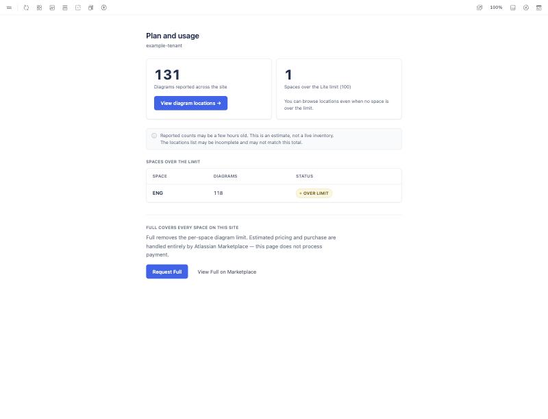
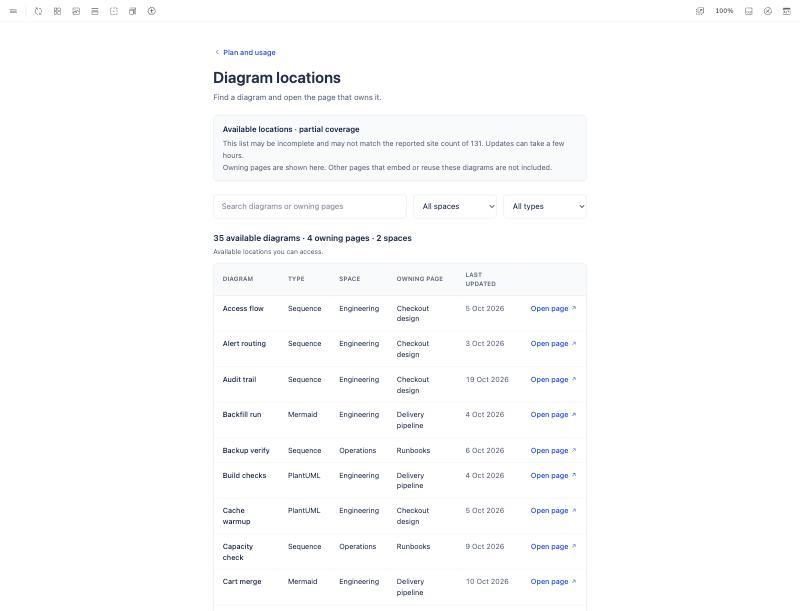
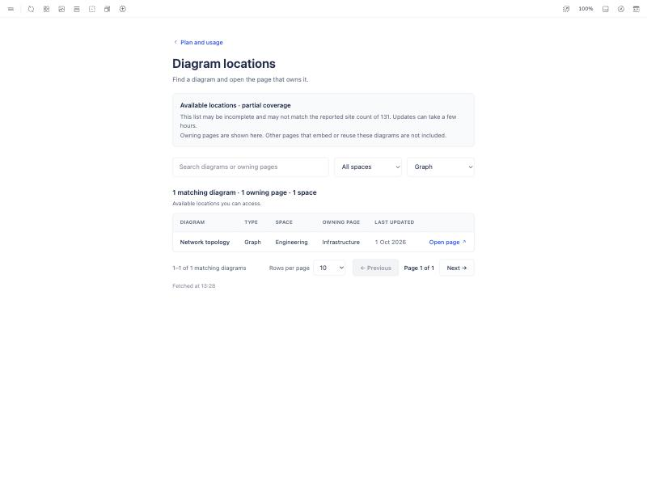
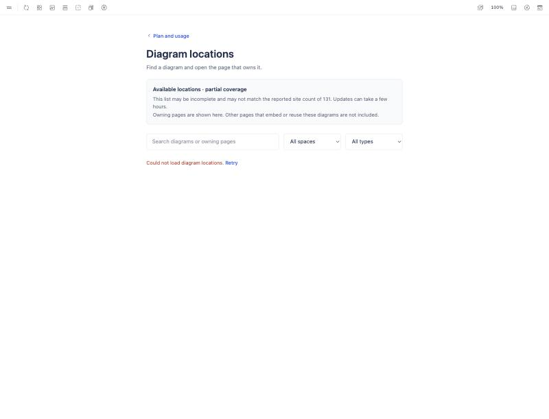
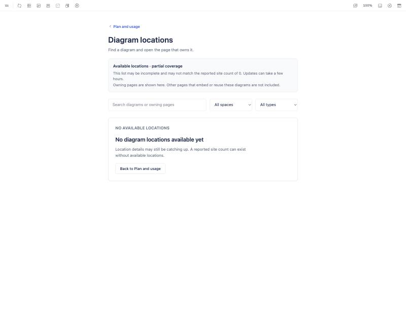
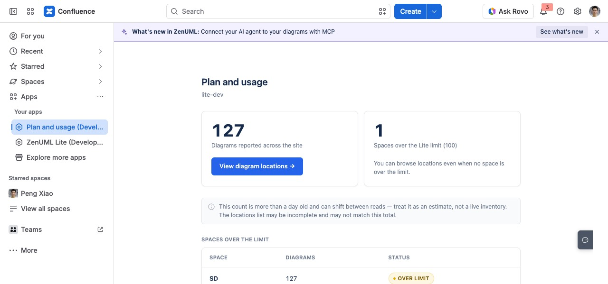
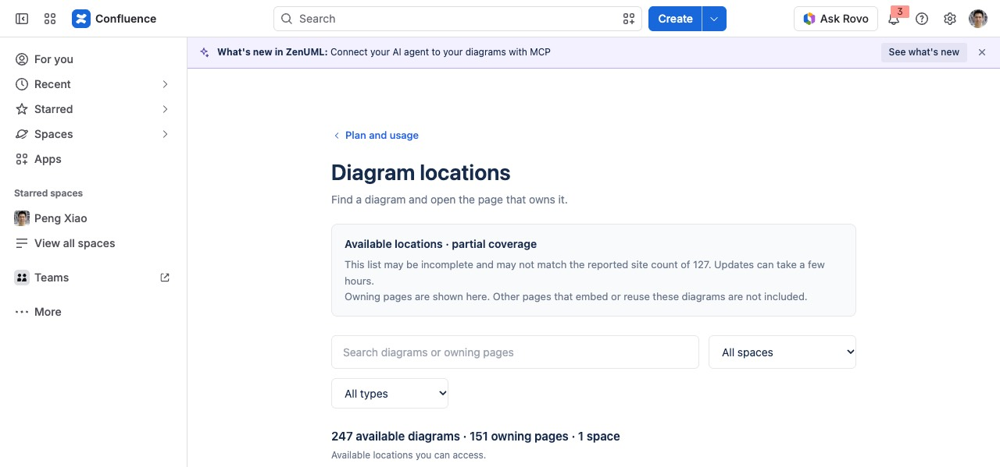
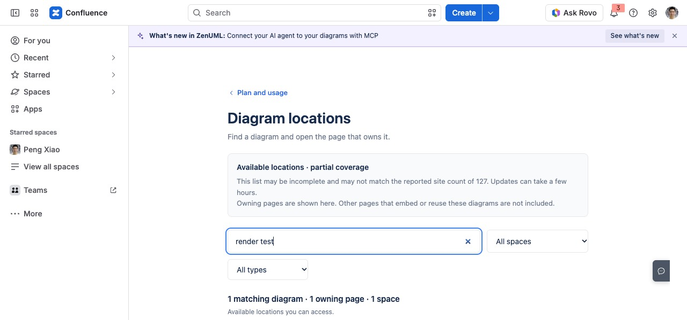
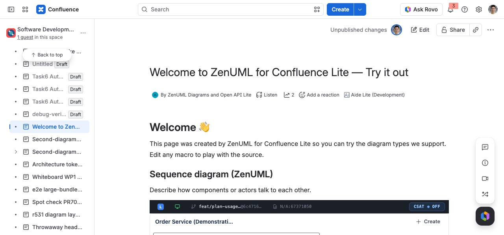

# Diagram locations (Plan and usage)

The "Diagram locations" screen behind **View diagram locations** on the Lite
**Plan and usage** page (`confluence:globalPage` `zenuml-plan-usage-page`).
Design: Conf App Figma, section *04 · Diagram locations · #848*
(frames 147-229, 147-256, 147-356, 147-397). Code:
`src/components/PlanUsage/DiagramLocations.vue`,
`src/utils/planUsage/diagramLocations.ts`, `functions/api/plan-usage.ts`.

## What the admin sees

The count card gains **View diagram locations**. The screen lists the site's
stored diagrams with the page each one was created on (its owning page), the
space, the diagram type, the last save and **Open page**, which opens that
page in a new tab. Search matches diagram and owning-page titles; space and
type filters, rows per page (10 / 25 / 50) and Previous / Next follow the
design's pagination spec. Loading, no-results, empty and failure states are
distinct; failure keeps the search and filters and offers Retry.

## Data path

Everything is read as the viewer through `requestConfluence`, so Confluence
applies their space and page permissions: a space the viewer cannot see is
dropped from the list without being named, and a record whose page they
cannot read is dropped from the rows. `/api/plan-usage` adds `spaces` (every
space with a reported count, largest first); the screen resolves those keys
with one bulk `/api/v2/spaces?keys=` call, then reads each space's custom
content (100 raw records a fetch, owning pages resolved with bulk
`/api/v2/pages` and `/api/v2/blogposts` lookups). A run pauses after 500
records with **Load more spaces**. Nothing is fetched until the screen opens.

Counts are stored diagrams, never macro placements: a page that embeds a
diagram stored on another page is not enumerated (the coverage note says
so). Embed-type records appear with type **Embed**.

## Evidence

Storybook (`Plan and usage/PlanUsage`, fictional fixtures):

| Plan and usage | Diagram locations | Filters | Load failed | Empty |
|---|---|---|---|---|
|  |  |  |  |  |

Forge tunnel on the `lite-dev` development site (branch `feat/plan-usage-diagram-locations`, iframe served from `localhost:8000`):

| Plan and usage | Diagram locations (live) | Search | Opened owning page |
|---|---|---|---|
|  |  |  |  |
