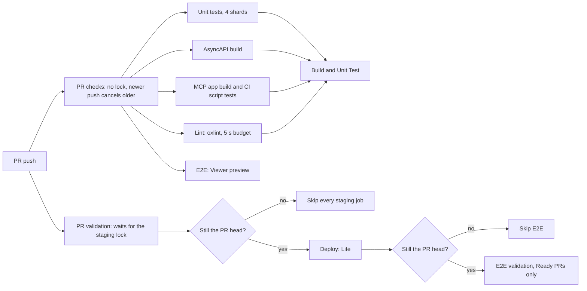
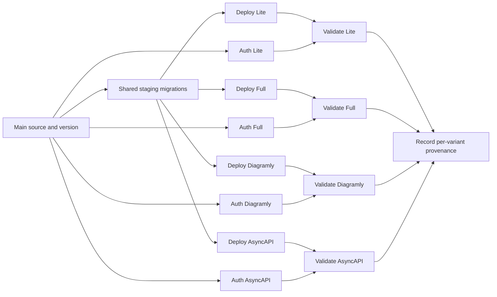

# Pipeline graphs

PR validation and main preparation have separate entry workflows.

A PR push starts two workflows. Only `PR validation` takes a lock, `conf-app-pr-slot`, because a workflow-level concurrency group holds back every job of its run. That lock belongs to the PR slot (Forge environment `pr`, site `lite-dev`, backend `conf-stg-lite-pr.zenuml.com`); `main` and the daily regression use `conf-app-staging` and the staging slot, so PR runs and `main` runs do not wait for each other.

| Event while a run is active | PR checks | PR validation |
|---|---|---|
| Newer push, old run still queued for the lock | Old run cancelled | Old run gets the lock, skips everything, releases the lock |
| Newer push during the deploy | Old run cancelled | Deploy finishes, E2E is skipped; cleanup looks for a child run for up to 60 s, then releases the lock |
| Newer push during E2E | Old run cancelled | E2E finishes on the old commit |
| Draft marked Ready, same commit | Not started again | Runs with E2E |
| `test:all` dispatch | Not started | Runs with full E2E |
| GitHub API error during the head check | Not applicable | Validates anyway |

The main graph has five jobs: Source and version, Build preparation, Staging validation, Draft preparation, and Pipeline outcome. Build preparation and Staging validation run in parallel. Each phase is a called workflow, so its jobs run inside the root run and appear there as `<Phase> / <job>` (for example `Staging validation / Validate: Lite / regression / shard 1/4`). There is no child run to dispatch, poll or verify.

The build phase contains unit tests, preview tests, production bundles, and the cron deployment. The staging phase contains deployment, login preparation, and validation for each variant. Each variant validation calls its E2E workflow inside the staging run (`Validate: <Variant> / …` jobs: a backend check, plans, shards, evidence, and reports); it is not a separate run, so it needs no dispatch, polling or parent-ownership check. The draft phase reads the build and staging provenance artifacts from the same root run and creates drafts only for variants whose original validation gates passed. A failed variant still fails the root run; other eligible drafts remain available.

Every checkout uses the root source SHA. Each phase starts with `Read root options`, which downloads and verifies `main-root-options-<attempt>` from its own run and attempt. Only the root acquires the shared staging concurrency group; inside it, `staging-deploy.yml` resolves its own lock to `staging-inner-<run>-<variant>`, because `github.workflow` in a called workflow is the root's name. Cancelling the root cancels every phase job with it.

PR selection retains smoke and Jev-selected categories, with full coverage fallback. The human `test:all` override uses the PR entry. Main applies shared staging D1 migrations once, then deploys all four variants independently. Each validator waits only for its own deploy and authentication plus `Read root options`. Daily full regression also runs all four variant transactions independently after its shared migration gate. Full has one validator; Lite results do not gate it. Drafts retain successful build, migration, per-variant validation, and daily regression gates.

Production release order remains Diagramly → Lite → Full at least seven days after Lite; AsyncAPI is independent.

Automatic recovery listens only to root workflows. It reads every page of the root's jobs, strips the `<Phase> / ` prefix and checks the failures before deciding whether they are E2E failures. A root started before the one-graph change still has phase child runs, and recovery reads those. Build, deploy, and draft failures prevent automatic retry. An eligible E2E failure triggers one complete root rerun, creating fresh attempt-specific producers.

The draft phase needs one more rule, because it goes red when a variant's E2E fails. That variant's draft is skipped, and the draft phase's `Draft gate outcome` fails on every draft job that is not green, skipped ones included. Recovery (`scripts/ci/phase-recovery.mjs`) reads the draft phase jobs and ignores those skips and the gate failure when each skipped draft's variant has a failed `Validate: <Variant>` job, or a failed `E2E auth: <Variant>` bootstrap, in the same root. These still block a rerun: a draft job that failed, failed root ownership or draft eligibility, a cancelled job, and a draft skipped although its variant validated (a closed daily regression gate, or a failed build or migration). For an older root, a draft child that cannot be found or is not a completed first attempt also blocks. Example: main run 38745939051, attempt 1 had `Validate: Full` and `Validate: Diagramly` red, `Draft: Full` and `Draft: Diagramly` skipped, and Run recovery 38747684585 declined to rerun it because it counted `Draft preparation` as a draft failure. A rerun also cuts new drafts under a new version, so drafts that attempt 1 already created for the passing variants stay behind as unused drafts.

Rerun a `main` root whole, never with `gh run rerun --failed`. `Source and version` uploads `main-root-options-<attempt>`, and `Read root options` in each phase downloads the artifact for its own root attempt. A failed-jobs-only rerun does not execute `Source and version` again, so the new attempt has no such artifact and every phase that the rerun starts stops at `Read root options` (then named `Verify root ownership`) with `no artifact matches any of the names or patterns provided`. This happened on run 38745939051: the `--failed` rerun was attempt 2 and failed in child run 38748851591; a plain `gh run rerun 38745939051` was attempt 3 and passed. Recovery itself always uses the plain form. The attempt-scoped artifact is deliberate (it binds the options to the exact root source and attempt), so this is a rule for humans, not a defect to redesign.

## View the new graph

Start a new run from the revision containing these workflows. An old run retains its original workflow definition when rerun. The root run page shows every phase job; open a variant validation job for its test shards.

The phase workflows and root land together: a called workflow is read from the same commit as the root. Other artifacts that a later job reads by name with `gh run download` carry an attempt suffix (`main-root-options-<attempt>`, `daily-gate-<attempt>`), because a partial rerun keeps the earlier attempt's artifact of the same name in the run. `actions/download-artifact` picks the newest of same-name artifacts, so the others need no suffix (tested on a probe run, 2026-11-23).
