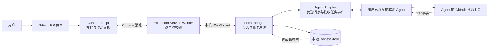
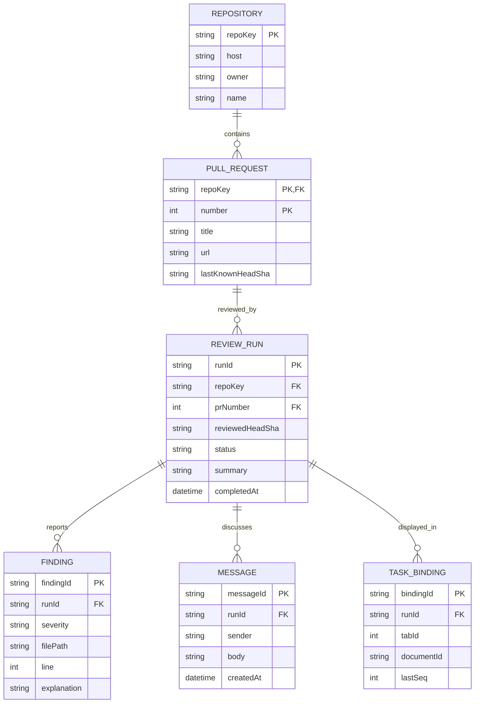
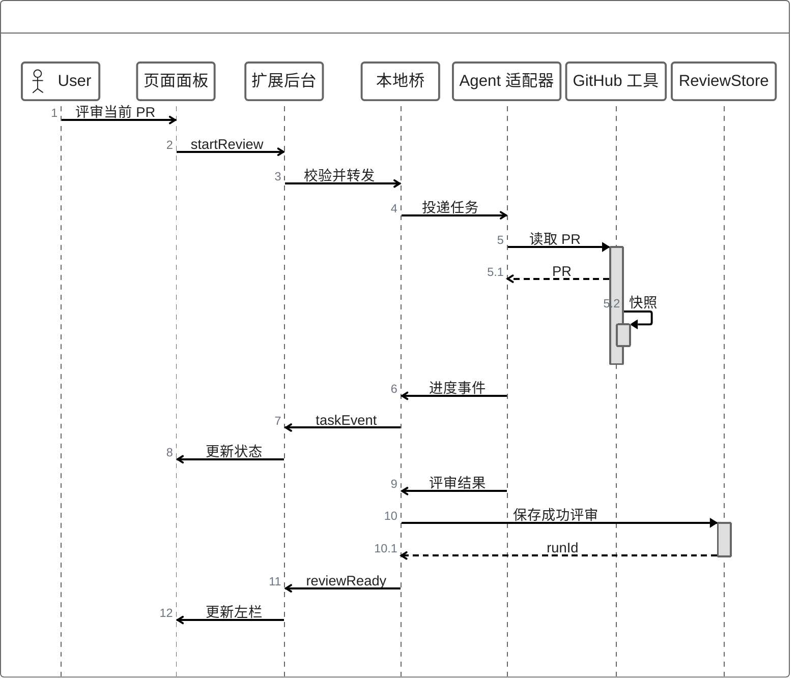

# GitHub PR Agent Panel — 架构提案

本设计对应 GitHub PR 页面上的 ZenUML Agent Panel 和左侧 AI 评审栏。左栏只出现**已有成功 AI 评审结果**的 PR；画板中的四条 PR 是交互示例，不能据此认定它们已真实经过 AI 处理。这是一份拟议架构，不表示浏览器插件已经实现。

## 1. 组件

| 组件 | 责任 | 边界 |
|---|---|---|
| Content Script | 在 GitHub 页绘制左栏、选中态、Agent Panel；读取当前仓库和 PR 的页面身份 | 仅展示、发起用户操作，不持有 Agent 或 GitHub 密钥 |
| Service Worker | 验证消息来源、管理标签页连接、把页面事件转给本地桥 | Chrome 扩展的特权边界；不依赖常驻内存保存任务状态 |
| Local Bridge | 绑定标签页与 Agent 任务、分发进度、处理断线重连、持久化评审 | 只监听本机地址；对消息做版本和权限校验 |
| Agent Adapter | 适配具体 Agent 的 `sendMessage`、`cancelTask`、`onEvent` 能力 | 这是双向通信所需接口；MCP 工具本身不保证能主动投递到任意 Agent 会话 |
| GitHub 读取工具 | 读取 PR 内容、变更和当前 head SHA，供 Agent 评审 | 沿用用户为该 Agent 配置的 GitHub 访问方式；插件不另存凭据 |
| ReviewStore | 保存成功评审、发现项、对话和任务游标 | 第一版建议本机 SQLite；跨设备共享另作决策 |

Chrome 官方文档将 Content Script、Service Worker 与消息通道分开，并要求后台校验来自 Content Script 的输入。[消息机制](https://developer.chrome.com/docs/extensions/develop/concepts/messaging)、[Service Worker](https://developer.chrome.com/docs/extensions/develop/concepts/service-workers)。本机 WebSocket 是本提案的传输选择，具体连接与扩展权限需在实现时验证。

## 2. 数据模型

**左栏查询规则：**按 `repoKey` 找到存在 `status = completed` 的 `REVIEW_RUN` 的 PR，每个 PR 展示最新一次成功评审。只有失败、取消或尚未开始的任务，不进入左栏。`reviewedHeadSha != lastKnownHeadSha` 时保留旧评审并标记“PR 已更新”，避免把过期结论当成当前结论。`lastKnownHeadSha` 只在打开页面或 Agent 再次读取该 PR 时更新；不为填充左栏而抓取所有 PR。

**来源规则：**PR 标题、状态、提交 SHA 来自 GitHub；AI 摘要和发现项来自成功评审记录；运行中状态来自 Local Bridge。`FINDING` 应带文件、行号和评审提交 SHA，才能定位到产生结论的版本。GitHub 的 PR 和 review API 能提供 PR 与原生 review 数据，但本方案的 AI 评审记录是独立数据，不能自动等同于 GitHub review。[PR API](https://docs.github.com/en/rest/pulls/pulls)、[Review API](https://docs.github.com/en/rest/pulls/reviews)。

## 3. 通信与任务生命周期

消息统一带 `protocolVersion`、`requestId`、`eventId`、`repoKey`、`prNumber`、`headSha`、`tabId`、`documentId`、`seq` 和 `payload`。Local Bridge 按 `eventId` 去重，按 `seq` 补发断线期间的任务事件；页面刷新后以新的 `documentId` 重新绑定，旧页面事件不得更新新页面。用户从面板发出的文字走 `Panel → Bridge → Agent Adapter`；Agent 回答和进度沿反方向回到面板。取消只结束当前任务，不删除已保存的成功评审。

## 4. 身份、存储与实现边界

- **本提案的接入方式：**继续使用用户已经连接的本地 Agent 及其 GitHub 读取工具。插件本身不引入新的模型提供商、API 计费渠道或 GitHub 登录方式；实际接入前需要确认该 Agent Adapter 是否提供可调用的消息和任务事件接口。模型费用遵循用户现有 Agent 配置，本设计没有可核实的新费用数值。
- **本地持久化：**建议先用 Local Bridge 管理的 SQLite。浏览器重启后左栏仍可恢复，Agent 也能读取同一份评审。跨设备或团队共享需要另外确定服务端存储、权限和费用。
- **权限：**页面脚本只接收显示所需的结果；扩展后台校验发送者、仓库和标签页；本地桥限制到 `127.0.0.1` 并校验扩展来源及配对凭证。GitHub 页面内容作为输入数据校验，不能当作给 Agent 或桥接层的指令。
- **写入 GitHub：**第一版的 AI 评审存于 ReviewStore；发布评论、提交 review 或修改 PR 是独立的用户操作，不由“完成评审”自动触发。

### 尚需验证的两个产品决定

1. **Agent 适配器：**选定要支持的第一个 Agent 后，验证它能否接受面板发来的消息并推送任务事件。若只能通过 MCP 工具被动调用，需由适配器提供任务收件箱或轮询机制。
2. **评审共享范围：**个人本地记录足以支持当前左栏；如果团队成员也应看到同一份 AI 评审，再设计共享存储与访问控制。
