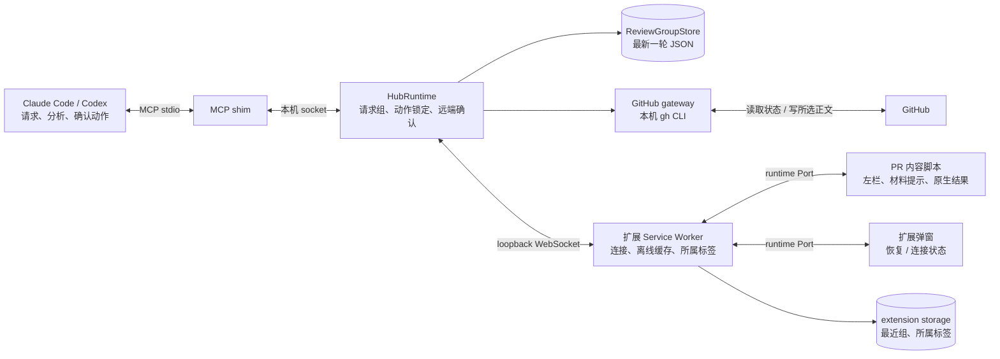
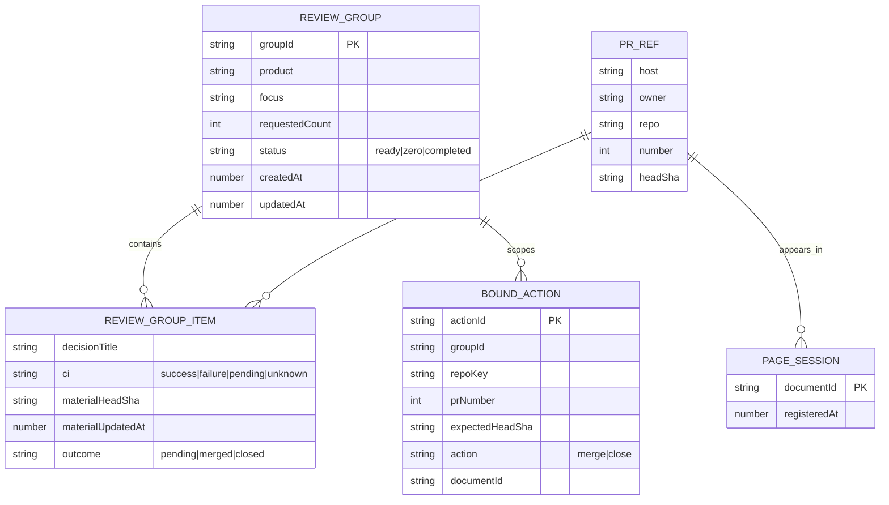
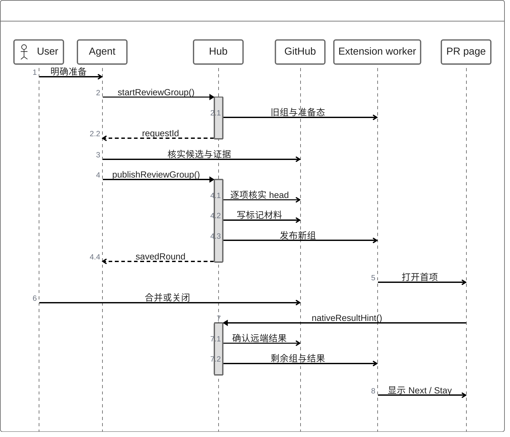

# GitHub PR Agent Panel 架构

该插件由 Chrome 扩展、本机 Hub、MCP stdio shim 和 Agent 技能组成。产品单位是**一次明确请求形成的有限 PR 组**。只有最新组会持久化；旧的本机评审历史继续保存以兼容旧工具，但不驱动当前左栏。

## 组件

内容脚本仅在当前 PR 是最新组的待处理成员时挂载左栏，或在本标签刚完成原生操作后暂时保留完成反馈；不挂永久网页聊天面板。`ReviewGroupList.vue` 平时呈现决策标题、CI 和当前项高亮，完成时另显示已完成项、下一项和操作按钮。材料提示插在 PR 正文之前。弹窗负责恢复当前轮次与连接设置。Service Worker 汇聚多个页面连接，只允许它创建和更新评审所属标签。Hub 校验请求版本、保存状态，并在必要时使用本机 `gh` 访问 GitHub。

## 数据模型

`ReviewGroupPreparation` 是内存中的准备态，含最新 `requestId`、产品、请求数量、开始时间和可选错误。开始新请求不删除已发布的组；只有对应的最新 `requestId` 成功发布才会原子替换 `review-group.json`。空选择发布 `zero` 组。组完成后状态为 `completed`，不会自动补足新 PR。`BoundAction` 在 Hub 内存中锁住组、PR 和 head；重启后必须重新绑定，避免旧动作误用。

Hub 将最新组原子写入 `~/.zenuml-pr-panel/store/review-group.json`（测试可用 `PR_PANEL_RUNTIME_DIR` 隔离）。扩展缓存 `group` 帧，供 Hub 离线时显示和弹窗恢复。PR 正文的材料采用 `<!-- zenuml-pr-review:start -->` / `end` 标记；更新只替换标记区，保留原正文。当前 head 与 `materialHeadSha` 不同为 stale；当前 head 缺失为 unknown，不能证明材料有效。PR 身份、标题、正文和 SHA 不进入统计属性。

## 通信与顺序

扩展先用 `GET /` 识别本机 Hub，再用 WebSocket 和子协议 `zenuml-pr-panel` 交换 JSON 帧。握手协议版本为 2；不匹配时拒绝连接。页面通过 `register` 和浏览器标签激活事件更新当前 PR，Agent 无需手动点“设为活动”。`listGroup` 取完整快照；Hub 在组状态变化时广播 `group`。断线时浏览器缓存最近组；重连后 Hub 的持久化快照为准。

MCP 工具负责 `start_review_group`、`publish_review_group`、`fail_review_group`、`get_review_group`、`bind_review_action`、`confirm_review_action` 和 `refresh_review_material`。材料写入只发生在显式准备或刷新工具调用。发布前先预检所选 PR，写每个 PR 时再核实 head；若任一步失败，保留旧组并显示错误。GitHub 不提供多 PR 正文事务，因此发生中途失败时，已写入的材料可能留在先前选中 PR；组仍不会切换。

Hub 以远端 GitHub 状态作为合并/关闭结果依据：未确认则项目留在组内；已确认则移除待处理集合，重复通知不会重复完成。原生操作仅原操作标签显示完成反馈：左栏暂时保留该已完成项并高亮下一项，底部提供 Next PR / Stay；三秒倒计时跳转由任何页面交互取消。最后一项显示本轮完成，不补位。AI 操作只有所属评审标签仍显示绑定目标时才可更新 URL，且不激活窗口或其他标签。定时远端同步发现的外部变化只更新组，不导航。CI 同步只改行内状态，不重写材料。

旧 `ReviewStore`、任务和消息工具仍供兼容读取；网页不再展示它们形成的永久清单。Hub 不启动模型，也不授予合并权限。
