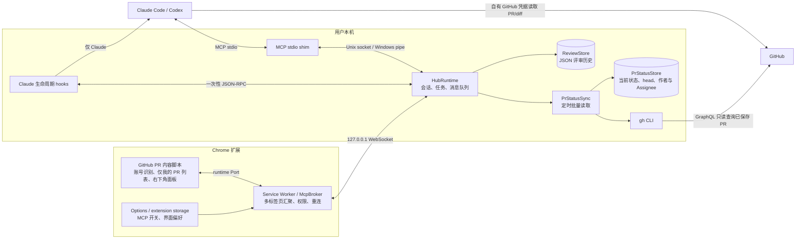
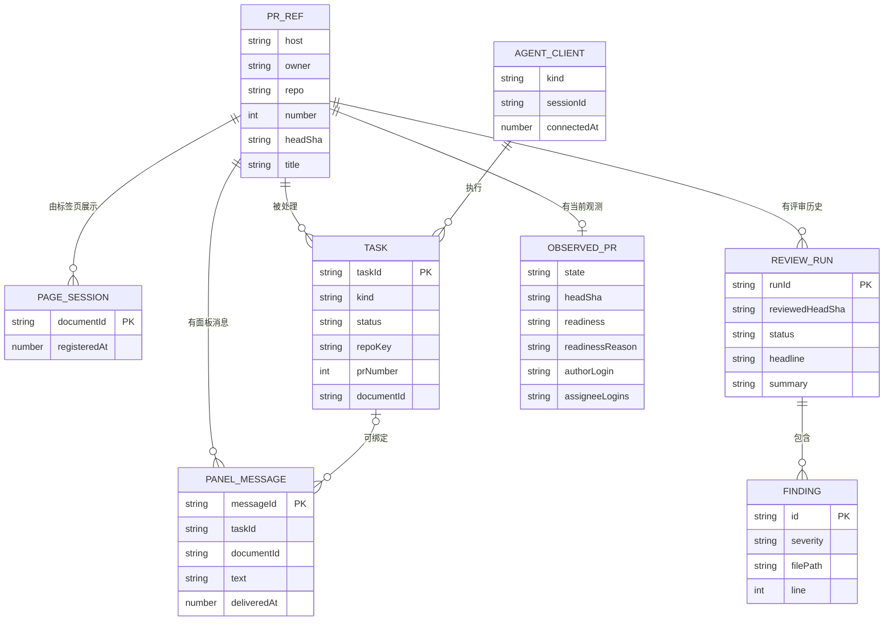
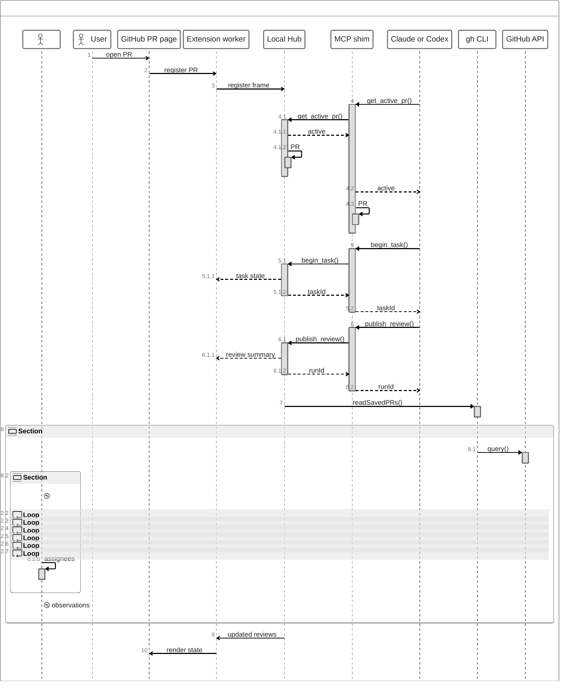

# GitHub PR Agent Panel 架构设计

本文描述当前源码实现。插件由 Chrome 扩展、本机 Hub、MCP shim 和 Claude Code 插件组成；Codex 使用同一个 MCP shim。扩展负责识别当前 GitHub PR 并显示状态，Agent 用自己的 GitHub 权限读取代码；Hub 还通过本机 `gh` 登录刷新已保存评审的 PR 状态。

## 组件

| 组件 | 职责 | 主要实现 |
| --- | --- | --- |
| 内容脚本 | 从 URL/页面读取 `PrRef`；在 Shadow DOM 中放置面板和评审列表；GitHub 软导航后重新注册 PR | `extension/src/content/controller.ts`, `extension/src/pr/identity.ts` |
| Service Worker | 每个浏览器配置一条 Hub 连接，汇聚各标签页的 runtime Port；缓存最近状态；断线后重注册页面 | `extension/src/bridge/broker.ts`, `extension/src/bridge/hub-client.ts` |
| Hub | 校验扩展帧、维护活动页面和 Agent 任务、分发消息、提供 MCP 工具 | `hub/src/runtime.ts`, `hub/src/websocket-server.ts`, `hub/src/mcp-server.ts` |
| MCP shim | 在 Agent 的 stdio 与 Hub 的本机 socket 之间转发 MCP JSON-RPC；必要时按需启动 Hub | `hub/src/cli.ts`, `hub/src/consumer-transport.ts` |
| Claude hooks | 在 Claude 生命周期边界读取面板消息、绑定任务、处理 Stop；Codex 没有这一路径 | `agent-plugin/hooks/hooks.json`, `agent-plugin/clients/shared/lifecycle.mjs` |
| ReviewStore | 把已发布的评审运行记录写入本机 JSON 文件，并按 PR 提供历史和最新摘要 | `hub/src/review-store.ts` |
| PrStatusSync / PrStatusStore | 枚举有已完成评审的 PR，以 `gh` 批量读取其当前状态和 head SHA；单独缓存并广播变更 | `hub/src/pr-status-sync.ts`, `hub/src/github-pr-reader.ts`, `hub/src/pr-status-store.ts` |

## 数据模型

`PrRef` 是页面身份：`host/owner/repo/number`；`repoKey` 是前三项的小写组合。`PageSession` 用 `documentId` 区分标签页。Hub 只维护一个全局 `activeDocumentId`，因此 `get_active_pr` 返回当前激活标签页的 PR，不是每个 Agent 会话各自固定的 PR。`Task` 记录 Agent、PR、进度和状态；它的运行时 `runId` 指向最近一次发布的评审，持久化的 `ReviewRun` 没有任务外键。`PanelMessage` 可绑定任务，也可只绑定 PR。`ReviewRun` 记录一次评审及其 findings；左侧列表由每个 PR 最新的 `completed` 记录派生。`ObservedPr` 是 GitHub 当前状态、head SHA 与合并信号，覆盖列表摘要中的当前字段；当前 head 与评审时不同则标记 stale。评审历史保持原值。`P0` 是评审输入中的显式业务优先级，不由合并状态自动推导。

`ReviewRun` 持久化到 `~/.zenuml-pr-panel/store/reviews/`，`ObservedPr` 缓存在同一 store 下的 `pr-status.json`（或配置的 store 目录）。页面会话、任务和面板消息保存在 Hub 内存中；浏览器偏好另存于 Chrome extension storage。`publish_review` 写本机记录，不创建 GitHub 评论。

左侧列表默认只显示当前 GitHub 登录账号创建、或被明确设为 Assignee 的已保存评审。内容脚本从 GitHub 页面的 `user-login`／`octolytics-actor-login` 元数据识别账号，Hub 用 `gh` GraphQL 同步 PR 作者和 Assignee。两个元数据值冲突、身份缺失或 PR 归属信息缺失时，内容脚本不显示该条目；筛选在每次 Hub 列表广播后重新执行。Requested reviewer 不作为默认负责关系。Hub 仍同步所有已保存 PR 的状态，不因分页或个人筛选跳过历史记录。

## 通信

1. **扩展 → Hub。** 用户开启 MCP access 并批准 `http://127.0.0.1/*` 后，Service Worker 探测 47391–47394 端口的 `GET /`，核对服务和协议版本，再以 `zenuml-pr-panel` 子协议建立 WebSocket。扩展和 Hub 交换带 `v=1`、`id`、`ts` 的 JSON 帧：`register/activate/listReviews/userMessage/cancelTask` 等请求，以及 `state/reviews/taskEvent/messageQueued/messageDelivered` 等响应。一个 WebSocket 承载同一浏览器配置中的多个标签页。
2. **Agent → Hub。** Claude Code 或 Codex 启动 `cli.mjs` 作为 MCP stdio server。shim 用启动锁复用同一 Hub，把 MCP 流经 Unix socket（Windows 为 named pipe）转发；Hub 暴露 `get_active_pr`、`begin_task`、`report_progress`、`post_message`、`publish_review`、`complete_task`、`read_review_history`、`delete_review_entry`、`list_panel_messages`、`wait_for_panel_messages` 十个工具。`delete_review_entry` 按明确的仓库和 PR 编号删除该 PR 的全部本机评审运行记录，然后广播更新后的列表；旧评审不会重新成为可见条目。
3. **面板消息 → Agent。** 消息先按 PR 进入 Hub 内存队列。Claude hooks 可在提示、工具调用和停止等生命周期边界领取；Codex 必须主动调用 `list_panel_messages` 或最长 25 秒的 `wait_for_panel_messages`。领取时同步标记 `deliveredAt`，避免两个通道重复领取；未绑定任务的消息仍可能由先轮询的会话取得。
4. **评审结果 → 页面。** Agent 自己读取 GitHub PR 和 diff，然后调用 `publish_review`。Hub 写入 ReviewStore，广播评审摘要和任务事件；Service Worker 转发给内容脚本更新界面。扩展本身不调用 GitHub API 读取代码。
5. **当前状态 → 左侧列表。** Hub 启动后及运行期间每五分钟枚举全部有已完成评审的 PR，用本机 `gh` 登录按每批最多 20 个 GraphQL 别名读取当前状态、草稿标志、head SHA、`mergeable`、`mergeStateStatus`、作者和 Assignee。重连、列表请求和新评审可触发合并刷新；失败后退避，保留最近一次已知值。变更按仓库广播现有 `reviews` 帧。GitHub 明确返回 `MERGEABLE` 且 `CLEAN` 的开放非草稿 PR 才标为 `ready`；有冲突或明确阻塞标为 `blocked`；检查状态不明或 `UNSTABLE` 标为 `unknown`。这一保守映射依据 [GitHub 的 MergeStateStatus 定义](https://docs.github.com/en/graphql/reference/pulls#mergestatestatus)。内容脚本先按当前 GitHub 账号筛出“仅我的 PR”，再将显式 P0 固定在顶部，并按可用高度和实际行高分页其余条目；分页只改变本地显示范围，不改变后台同步范围。

## 边界与运行约束

- Hub WebSocket 只绑定 `127.0.0.1`，要求 Chrome 扩展 Origin、固定路径和子协议；默认允许任意格式合法的 Chrome 扩展 Origin，部署者可用 `PR_PANEL_ALLOWED_EXTENSION_ORIGINS` 收紧到具体扩展 ID。当前协议没有配对令牌。
- MCP access 默认关闭；未取得本机 host permission 时，扩展不探测 Hub。Hub 与扩展的协议版本不匹配时拒绝连接。
- Hub 的 socket、锁和运行状态默认放在操作系统临时目录，评审历史默认放在用户主目录。不同 Agent 若使用不同 `TMPDIR`，可能连接到两个 Hub；可统一 `PR_PANEL_RUNTIME_DIR`。
- 同一 PR 可同时存在多个任务；面板优先显示最近开始的进行中任务。多个 Agent 同时评审同一 PR 时，消息归属和最新结果容易混淆。
- Hub 仅在配置 `PR_PANEL_MIXPANEL_TOKEN` 时发送白名单统计属性；仓库名、PR 标题、diff 和评审文本不在该属性白名单中。

模型和代码读取由运行 Agent 的 Claude Code/Codex 环境负责。Hub 使用其进程可访问的本机 `gh` 登录仅读取已评审 PR 的元数据；它不启动模型，也不向 GitHub 发布评审。
