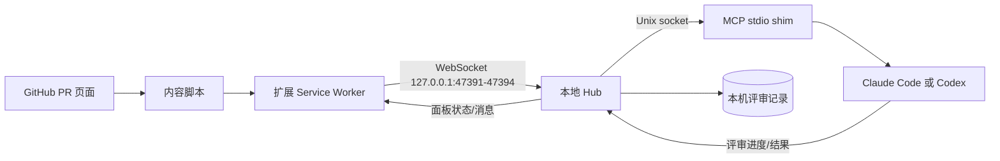

# ZenUML GitHub PR Agent Panel 使用指南

ZenUML PR Agent Panel 是一个运行在 `github.com` Pull Request 页面上的 Chrome 扩展。它把你已经打开的 Claude Code 或 Codex 会话连接到当前 PR：

这里的 Claude 指 Claude Code。Claude Desktop 的聊天列表不会显示 Codex 或 Claude Code 的会话；本插件的 Hub 也不保存完整聊天记录供另一个客户端打开。

- GitHub 左侧显示当前仓库已经完成的 AI 评审；
- 右下角的 Agent Panel 显示连接状态、当前任务、最新评审和消息；
- AI 仍使用你自己的 Claude Code 或 Codex 会话和权限读取代码；本地 Hub 不会启动模型，也不会替你向 GitHub 发布评论。

扩展不运行在 Confluence 页面内。当前版本的安装方式是从仓库源码构建并在 Chrome 中加载 unpacked extension。

## 当前发布状态

截至本文编写时，仓库没有 Chrome Web Store 扩展 ID 或下载链接，扩展和 Hub 的 workspace `package.json` 也标记为 `private`。只读查询 npm registry 时，以下名称均未发布：

```text
@zenuml/pr-panel-hub
pr-panel-mcp
@zenuml/pr-panel-extension
```

因此当前不要使用商店链接，也不要使用 `npx pr-panel-mcp`。下面的命令都从已经包含 `packages/pr-agent-panel/` 的仓库根目录执行。

## 使用前准备

需要：

1. Chrome 116 或更新版本。扩展的 Manifest V3 配置声明了 `minimum_chrome_version: 116`。
2. Node.js 22 或更新版本。Hub 的 `engines` 要求为 `node >=22`。
3. pnpm 10（仓库根目录的 `package.json` 声明了 `pnpm@10.34.5`）。
4. 一个可用的 Claude Code 或 Codex 会话。
5. 如果要让 Agent 读取 PR，准备好对应会话自己的 GitHub CLI 登录状态：

   ```bash
   gh auth status
   ```

   Agent 使用自己的 `gh` 权限读取 PR 和 diff；Hub 也使用其进程可访问的本机 `gh` 登录，仅读取已评审 PR 的状态。扩展不会把 GitHub 登录凭据交给 Hub。

## 从源码安装扩展

在仓库根目录运行：

```bash
pnpm install
pnpm --filter @zenuml/pr-panel-hub build
pnpm --filter @zenuml/pr-panel-extension build
```

然后在 Chrome 中：

1. 打开 `chrome://extensions`，开启 **Developer mode**。
2. 点击 **Load unpacked**。
3. 选择 `packages/pr-agent-panel/extension/.output/chrome-mv3`。
4. 打开扩展的 **Details → Extension options**，或在 GitHub PR 面板的 Preferences 中打开设置。
5. 点击 **Enable MCP access**，接受访问 `http://127.0.0.1/*` 的可选权限。

MCP access 默认关闭。关闭时扩展不会探测本机端口。成功连接后，设置页会显示类似 `Connected to the Hub on port 47391` 的状态；Hub 也可能使用 47392、47393 或 47394。

## 连接图



第一个 Agent MCP 连接会按需启动 Hub。多个 MCP shim 会通过启动锁复用同一个 Hub；不需要手动运行后台服务。

## 配置 Claude Code

### 当前源码版的启动方式

Hub 构建完成后，先在当前项目的 Claude Code 配置中注册本地 MCP server：

```bash
claude mcp add --scope local pr-panel -- node "$PWD/packages/pr-agent-panel/hub/dist/cli.mjs"
```

再从仓库根目录用插件启动 Claude Code：

```bash
claude --plugin-dir "$PWD/packages/pr-agent-panel/agent-plugin"
```

这个插件目录提供三部分能力：

- `hooks/hooks.json`：在 `UserPromptSubmit`、`PreToolUse`、`PostToolUse`、`Stop` 和 `SessionEnd` 生命周期读取面板消息，并把消息作为当前会话上下文交给 Claude；
- `skills/review-pr/SKILL.md`：指导 Claude 按 `get_active_pr → begin_task → 读取 diff → report_progress → publish_review → complete_task` 完成评审；
- `plugin.json`：声明上述 hooks、skill 和 MCP 配置。

当前源码中的 `plugin.json` 引用了 `agent-plugin/.mcp.json`，但该文件未被 Git 跟踪（仓库的 `.gitignore` 忽略 `.mcp.json`）。`claude plugin validate` 因此报告缺少 MCP 配置文件；插件加载器会跳过该文件，不会从插件自动注册 MCP server。上面的 `claude mcp add` 是当前源码版访问 MCP 工具所需的显式注册步骤。启动后还应在 Claude Code 中确认 hooks 和 skill 已加载。正式发布时需要补齐并验证插件分发方式。

注册或安装插件后，重新打开 Claude Code 会话，确保 MCP 工具和 hooks 已加载。打开 GitHub PR 后，对 Claude 说：

```text
review the PR in the panel
```

Claude 会先调用 `get_active_pr`，再开始任务。首次使用时可能需要在 Claude Code 中批准 `pr-panel` MCP server；也可以按 Claude Code 的权限策略允许整个 server。

## 配置 Codex

当前源码版不要使用 npm 包名，直接把构建产物注册为 stdio MCP server：

```bash
codex mcp add pr-panel -- node "$PWD/packages/pr-agent-panel/hub/dist/cli.mjs"
codex mcp get pr-panel
```

注册后新开一个 Codex 聊天。已经存在的聊天不一定会热加载新增的 MCP 工具。打开目标 GitHub PR 后，在新聊天中先调用：

```text
get_active_pr
```

返回的 `pr` 应该包含当前仓库、PR 编号和 URL；`pr: null` 表示 Hub 虽然可能已连接，但当前没有注册的活动 PR 页面。

Codex 版本没有 Claude 的 lifecycle hook。要读取用户在面板中输入的消息，Codex 必须主动调用 `list_panel_messages`，或使用最长 25 秒的 `wait_for_panel_messages`。Codex 空闲时不会因为用户在面板输入消息而自动唤醒。

## 第一次连接验证

按以下顺序检查：

1. Chrome 当前标签是具体 PR 地址：`https://github.com/<owner>/<repo>/pull/<number>`。仓库的 Pull Requests 列表页 `/pulls` 没有“当前 PR”。
2. 右下角面板的 MCP 圆点为绿色，或设置页显示已连接到 Hub。
3. Claude Code 或 Codex 的 MCP 工具列表中出现 `pr-panel`。
4. 调用 `get_active_pr`，确认 `pr` 非空。
5. 只有在第 4 步成功后，才开始 `begin_task` 或让 Claude 执行评审。

## 日常使用

### 切换 PR

在同一个 GitHub 标签中导航到另一个 `/pull/<number>` 页面，或打开新的 PR 标签。扩展会在 GitHub 的 soft navigation 后重新注册页面；如果扩展刚安装、刚重新加载，或页面早已打开，刷新一次目标 PR 页面，让内容脚本重新注入。

左侧评审列表只显示当前仓库已经完成的 AI 评审，每个 PR 显示最新的一次。PR 在评审后有新提交时，旧评审仍保留，但会标记为 `PR updated`（stale），提醒你重新评审。

### 发起和跟进评审

Claude 按插件 skill 执行评审流程；Codex 可按同样的工具顺序操作：

1. `get_active_pr` 确认页面；
2. `begin_task` 创建 `review` 任务；
3. 用 Agent 自己的 GitHub 工具读取标题、描述、diff 和相关源文件；
4. 使用 `report_progress` 更新面板任务状态；
5. 使用 `publish_review` 写入评审摘要、优先级和 findings；
6. 使用 `complete_task` 结束任务。

评审记录保存在本机，左侧列表只展示 `completed` 的运行记录。面板中的 **Stop** 会取消当前任务；取消后不要继续发布该任务的评审。**Done** 只关闭面板中的已结束任务行。

### 删除左侧评审条目

需要从本机面板移除某个 PR 的评审条目时，让 Agent 调用 `delete_review_entry`，明确传入仓库和 PR 编号：

```json
{
  "repo": { "host": "github.com", "owner": "example-org", "repo": "example-repo" },
  "prNumber": 42
}
```

返回 `{ "deleted": true, "deletedRuns": 2 }` 表示该 PR 的两次本机评审均已删除；不存在时返回 `{ "deleted": false, "deletedRuns": 0 }`。删除该 PR 的全部历史可防止旧评审重新成为左侧可见条目，其他 PR 的评审、当前任务和面板消息不受影响。删除不会修改 GitHub PR，也不会删除 GitHub 评论。删除后若正在运行的任务再次调用 `publish_review`，该 PR 会作为新评审重新出现在列表中。当前版本只提供 MCP 工具，没有面板内的删除按钮。

### 向 Agent 发消息

在面板消息框输入请求并发送。Claude 在当前回合的 hook 边界、下一次提示或等待阶段收到消息；如果 Claude 正在等待下一步输入，发送后仍需要继续提示它，除非它主动调用了等待工具。Codex 需要调用 `list_panel_messages` 或 `wait_for_panel_messages` 领取消息。

### 同时连接 Claude 和 Codex

Claude 和 Codex 可以同时连接同一个 Hub，通常不会因为端口而冲突。建议同一个 PR 同一时间只让一个 Agent 执行评审：

- 两个 Agent 可以各自创建任务；面板会同时收到共享状态，容易让人误判当前任务；
- 没有明确绑定任务的面板消息会由第一个匹配的 Agent 领取，可能被另一个会话消费；
- 两个评审都完成时，左侧列表和面板显示的是该 PR 的最新完成记录。

如果分别处理不同 PR，每次开始任务前仍要确认全局活动标签：`get_active_pr` 返回的是当前被激活的 PR 页面，不是每个 Agent 会话各自固定的 PR。

### 评审列表的当前状态和分页

Hub 运行时用本机 `gh` 登录，只读取已经保存过 AI 评审的 PR。它在启动时、每五分钟以及扩展重连或请求列表后刷新当前状态、head SHA 和 GitHub 合并信号；密集请求会合并。评审原文仍是评审当时的记录。GitHub 查询失败时保留上次已知状态；未知的合并条件不会显示为 Ready。

左侧列表按实际可用高度和条目高度自动分页，无固定每页条数。明确标记为 P0 的评审固定在顶部，仍显示其阻塞或未知状态；普通条目中，Ready 排在需要处理或确认的条目前面。筛选、调整窗口高度或删除条目后，页码会重新计算。翻页只改变本机显示，不发起新评审或 GitHub 写入。

## 故障排查

### 面板显示绿色，但 `get_active_pr` 返回 `pr: null`

绿色只证明扩展已经连上某个 Hub，不代表某个具体 PR 已注册。请按顺序检查：

1. 当前地址是否是 `github.com/<owner>/<repo>/pull/<number>`，而不是 `/pulls`、仓库首页或其他站点；
2. 是否刚安装或重新加载扩展；若是，刷新一次具体 PR 页面；
3. Chrome 扩展详情页是否显示扩展已启用，且当前页面是 `github.com`；
4. 如果同时开了多个 PR 标签，先在目标标签点击面板的 MCP 徽标使它成为 active tab，再调用 `get_active_pr`。

不要只看到绿色 Hub 状态就开始 `begin_task`；先确认 `pr` 非空。

### 页面没有面板或左侧列表

扩展只声明了 `https://github.com/*`，不会注入 GitHub Enterprise 或其他域名。确认使用的是具体 PR URL，扩展已在 `chrome://extensions` 启用，并在扩展安装或重新加载后刷新页面。GitHub 的 soft navigation 可能需要等待页面内容渲染完成后再检查。

### 设置页显示 “Hub not running”

Hub 通常由第一个 Agent MCP 连接按需启动。确认 Hub 已构建，并重新启动已注册 `pr-panel` 的 Claude Code 或 Codex 会话。若需要前台调试，可在仓库根目录运行：

```bash
node packages/pr-agent-panel/hub/dist/cli.mjs --hub
```

前台 Hub 会一直运行；调试结束后按该终端的正常退出方式结束它，避免同时启动多个前台 Hub。

### 出现两个 Hub、端口或消息不一致

Hub 的 socket 路径由 Node 的临时目录决定。若 Claude、Codex 或 hook 使用了不同的 `TMPDIR`，可能各自创建不同的 runtime 目录；它们会尝试不同的候选端口（47391–47394），导致 Agent 和扩展连到不同 Hub。

先确认设置页显示的端口、各会话的环境变量，以及哪个 Hub 正在被扩展使用。然后让所有会话使用相同的 `TMPDIR`，或者为所有 Agent 和 hook 设置同一个 `PR_PANEL_RUNTIME_DIR`，并重新打开 Agent 会话。macOS 上，如果 Codex 的 MCP 子进程未继承终端的 `TMPDIR`，可在仓库根目录重新注册，显式传入相同的值：

```bash
codex mcp remove pr-panel
codex mcp add --env TMPDIR="$TMPDIR" pr-panel -- node "$PWD/packages/pr-agent-panel/hub/dist/cli.mjs"
```

不要盲目 `kill` 进程或删除 runtime 目录。

### Codex 找不到工具

运行：

```bash
codex mcp list
codex mcp get pr-panel
```

确认 `command` 是 `node`，参数指向 `packages/pr-agent-panel/hub/dist/cli.mjs`。如果刚执行过 `codex mcp add`，新开 Codex 聊天让工具列表重新加载。若 Hub 构建产物不存在，重新运行 `pnpm --filter @zenuml/pr-panel-hub build`。

### Claude 没有收到面板消息

确认 Claude 是用 `--plugin-dir` 启动的，且该会话加载了 hooks。插件 hooks 只在生命周期边界读取消息；空闲会话不会凭空被唤醒。让 Claude 继续下一回合，或在请求中明确让它检查面板消息。若 MCP 工具本身没有加载，使用“配置 Claude Code”中的 `claude mcp add` 命令并新开会话。

## 隐私、存储与卸载

### 本地存储

- 评审记录（可包含 PR 标题、摘要和 findings）持久保存在本机。默认目录是 `~/.zenuml-pr-panel/store/reviews/`，文件以私有权限写入；面板消息在 Hub 和页面运行期间保存在内存中。Hub 的 socket、锁和运行状态放在操作系统临时目录。
- 设置（例如 MCP access、面板折叠状态）由 Chrome extension storage 保存。
- 设置 `PR_PANEL_RUNTIME_DIR` 后，runtime 和 store 使用该目录下的 `store/`；`PR_PANEL_STORE_DIR` 可单独覆盖评审记录目录。

### 网络与分析

Hub 只监听 `127.0.0.1`，扩展通过本机 WebSocket 与它通信。默认不发送 Mixpanel 分析；只有设置了 `PR_PANEL_MIXPANEL_TOKEN` 才启用，而且只发送次数、结果和耗时等统计，不发送仓库名、PR 标题、diff 或评审文本。Hub 不把评审内容上传到 ZenUML 服务；但你自己的 Claude Code/Codex 会话可能会按照其模型提供方的隐私政策把读取到的代码发送给对应模型服务。

### 关闭权限

在扩展的 Options 或面板 Preferences 点击 **Disable MCP access**。这样会停止扩展探测本机 Hub；如需完全撤销 `127.0.0.1` 的可选权限，可在 Chrome 的扩展详情页管理站点访问权限。

### 卸载

1. 关闭正在使用该 Hub 的 Claude Code/Codex 会话。
2. 在 Chrome `chrome://extensions` 中移除该 unpacked extension。
3. 如果曾手动注册 MCP，分别移除：

   ```bash
   codex mcp remove pr-panel
   claude mcp remove pr-panel
   ```

   `claude mcp remove` 只需要用于手动注册过的 Claude server；用 `--plugin-dir` 启动的插件本身不安装到全局目录。

4. 如果不再需要本机评审历史，在确认所有会话已退出后删除 `~/.zenuml-pr-panel/store/`，或删除你设置的 `PR_PANEL_STORE_DIR`。这会永久删除评审历史，删除前请先备份需要保留的记录。

## 正式发布前待补项

对外发布前，请在本文和发行说明中补齐：

- Chrome Web Store 的正式下载链接和扩展 ID；
- 已发布的 npm 包名、版本和安装命令（若继续提供 npm MCP 包）；
- 包含 `agent-plugin/.mcp.json` 的正式 Claude Code 插件分发方式，或明确要求用户使用 `claude mcp add`；
- 与发布版本一致的 extension、Hub、plugin 版本号；
- 不含内部 PR、客户数据或本机路径的安装截图；
- 受支持的 Node、Chrome、Claude Code、Codex 最低版本和变更日志。

在这些入口可验证之前，请继续使用本指南中的源码构建路径，不要把示例仓库路径、本机端口或未发布的 npm 名称当成公共下载入口。
