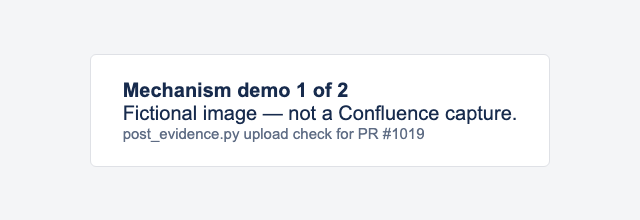
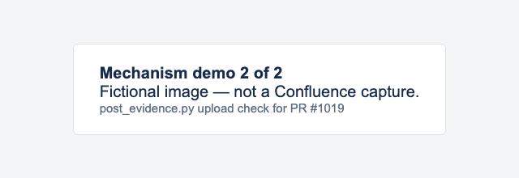

## Spot check — 2026-10-30 02:51 UTC

- Branch: `skill/issue-914-spot-check-pr-evidence` @ `69c10b5ff780`
- Site: `lite-stg.atlassian.net`
- Result: 2 PASS · 0 FAIL · 1 SKIPPED
- Evidence: this directory

Mechanism demo, run 2 (after the commit-message fix) — this run checks the posting helper itself, not a Confluence behavior. Both images are fictional HTML renders.

- PASS: first screenshot uploads and renders inline from a SHA-pinned URL
  
- PASS: second screenshot lands in the same evidence directory
  
- SKIPPED: live Confluence spot check — this PR changes only skill docs and a helper script

Posted by the spot-check skill (`post_evidence.py`). Ad hoc check, not a checked-in E2E test.
