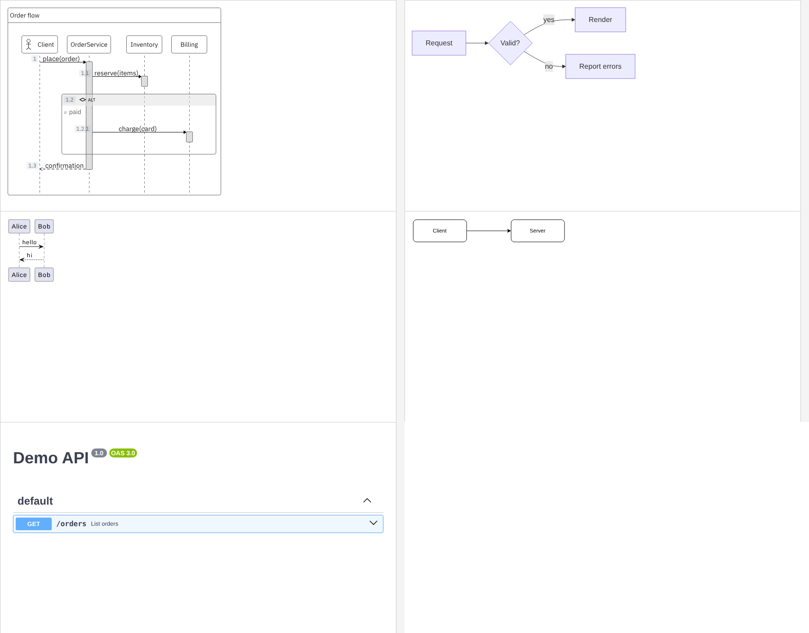

# PR #1024 evidence: public `/mcp/render` MCP endpoint

- BEFORE: `main` has no MCP endpoint that works without Atlassian sign-in.
- AFTER: `d485782c`, the PR head when this evidence was captured.
- Change type: a new backend endpoint (a Cloudflare Pages Function). It has no Confluence app UI change. What a user sees is the existing MCP Apps diagram view, drawn in the chat host.
- All fixtures are invented ("Order flow", Alice/Bob, "Demo API"). No customer data appears anywhere.

## Where it ran

| Deploy | URL | How it got there |
|---|---|---|
| Staging | `https://conf-stg-lite.zenuml.com/mcp/render` | CI, PR validation [run 41151961925](https://github.com/ZenUml/conf-app/actions/runs/41151961925), `Deploy: Lite / deploy` ✅ |
| Preview | `https://mcp-render-preview.conf-stg-lite.pages.dev/mcp/render` | `wrangler pages deploy --branch mcp-render-preview`, run by the agent at the user's request (a preview alias, not the staging production deployment) |

## 1. Endpoint probe, no token: `scripts/endpoint-probe.py <url>`

- [`probe-staging.txt`](probe-staging.txt): 17/17 PASS.
- [`probe-preview.txt`](probe-preview.txt): 16/17. The one FAIL is a bug in the probe at the time it ran, not in the server. The probe expected asset URLs on the staging host, while the preview correctly serves them from its own origin. The asset URLs were checked by hand: `https://mcp-render-preview.conf-stg-lite.pages.dev/mcp-app/assets/view-….js`. The probe now derives the origin from its argument, and the staging run used the fixed version.

The probe covers:
- `initialize`, `tools/list`, `resources/list`, `resources/read`;
- `render_diagram` for each type, with `diagramType` left out (detection) and given;
- syntax errors for sequence and Mermaid;
- refusal of an unknown type, empty source and an unknown tool.

## 2. The view draws every type: `scripts/simulated-host.cjs <url> <outdir>`

A Playwright page plays the MCP Apps host:
1. it fetches the view with `resources/read`;
2. it mounts the view in a `sandbox="allow-scripts"` srcdoc iframe, under a CSP built from the resource's `_meta.ui.csp`;
3. it completes `ui/initialize` → `ui/notifications/initialized`;
4. it delivers the `render_diagram` result returned by the same deploy.

Each source was sent **without** `diagramType`. Viewport 900×700; the iframe is 880×640.

Order (left to right, top to bottom): ZenUML sequence, Mermaid, PlantUML, draw.io, OpenAPI.

| Type | Staging | Preview | Drawn content | CSP violations |
|---|---|---|---|---|
| sequence | [png](staging/sequence.png) | [png](preview/sequence.png) | 13 SVGs, "Order flow" with an `if paid` block | none |
| mermaid | [png](staging/mermaid.png) | [png](preview/mermaid.png) | SVG flowchart | none |
| plantuml | [png](staging/plantuml.png) | [png](preview/plantuml.png) | `` from www.plantuml.com, naturalWidth 120 | none |
| graph | [png](staging/graph.png) | [png](preview/graph.png) | draw.io GraphViewer SVG, Client → Server | none |
| openapi | [png](staging/openapi.png) | [png](preview/openapi.png) | swagger-ui, "Demo API", `GET /orders` | none |

## Limits

- The simulated host follows the ext-apps handshake, but it is not claude.ai. That still needs a real custom connector.
- **Rate limit refusing calls:** verified only locally (workerd + local D1 with migration `0035`), where calls 31–32 were refused. Staging and the preview both let all 32/32 calls through, as designed, because their D1 databases have no `McpRenderRate` table yet. Creating the table in the preview database was blocked by the agent's permission policy.
