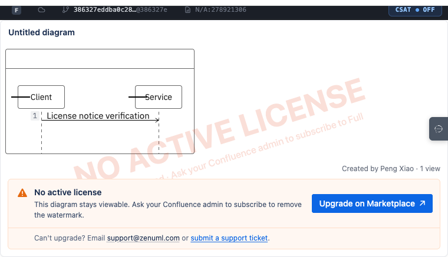
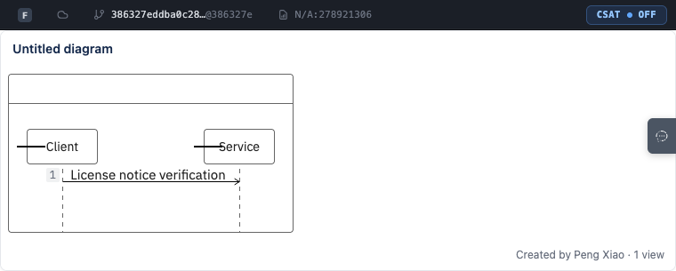

# License notice eligibility evidence

Candidate: `386327eddba0c2860a671e29ffedfc1ff9de2378` (`codex/license-notice-legacy-free`). Baseline: `d2553d9efd6da16388c70823242e8d58742c76ca` (merge-base with main).

## Comparable UI captures

Both images use the same Full GenericViewer Storybook fixture, 1280×577 viewport, diagram, missing Forge license and fresh synthetic Marketplace response. `before.png` runs the baseline GenericViewer and baseline licenseNotice module in the candidate Storybook harness; `after.png` runs the candidate files. The debug bar identifies the harness checkout in both images, not the copied baseline component. The temporary baseline copies were removed after capture.

Before: no notice. After: existing warning strip and watermark appear; diagram remains visible. No notice styling was changed.

Reproduce baseline capture: copy the two baseline modules from `git show <baseline>:<path>` to temporary sibling files, redirect the component's licenseNotice import to its baseline sibling, copy `LicenseNotice.stories.ts` to a temporary story pointing at the baseline component, then open `legacy-free-verified-marketplace`. Remove the temporary files afterwards. Candidate story: `Viewer/LicenseNotice/LegacyFreeVerifiedMarketplace`. Run Storybook with `PRODUCT_TYPE=full pnpm exec storybook dev -p 6006 --ci`.

## Ordered validation

1. Storybook PASS: real GenericViewer, stubbed Forge transport/rollout only. Explicit Legacy Free and fresh backend evidence show the notice; missing/unknown, expired evidence, active license and flag off hide it. See `storybook-results.json`.
2. Forge Tunnel PASS for candidate: real Chrome account matched Forge CLI. Live Full development macro debug bar reported the candidate; script elements were `/@vite/client` and `/src/forgeIndex.ts`; port 8080 had established connections. A real signed Forge request to the local FIT-verifying endpoint returned `legacy_free` and the warning and watermark were observed. Removing the isolated development record returned `unknown` and both disappeared. A separate 45-second record expired while the page stayed open and the UI removed both without a refresh. Synthetic record removed afterwards. See `tunnel-results.json` and the response-only `tunnel-endpoint-responses.json` (no request credentials).
3. CI Full Staging PASS: workflow `43005616007`, deploy job `130495929455`, application/tooling SHA both match the candidate; Forge `4.393.0`, Pages source `386327e`. Real CDN viewer asset `index-P_e024E7.js` and visible debug title identify the candidate. With no record: no notice or watermark, diagram visible. A fresh three-minute synthetic record: both visible. After its deadline, both disappeared without refreshing; the diagram stayed visible and no new endpoint request fired. Matching KV keys were empty after cleanup. See `staging-results.json`, observation JSON, and the response-status-only `staging-license-tail.jsonl`.

| Staging: evidence valid | Staging: evidence expired, no refresh |
|---|---|
|  |  |

Macro-only captures omit the tenant URL and surrounding site navigation. The debug preference was temporarily enabled to display the build, then restored. License mocks were absent. No Forge context or backend response was substituted. All available PR checks passed; the draft PR's Lite E2E path was intentionally skipped, while Viewer preview and Export PNG checks passed independently. See `ci-results.json` for exact runs.

The Tunnel uses real Forge authentication, not a mocked backend. Explicit Forge license type and active precedence are tested in Storybook and unit/component tests; nonproduction signed Forge license claims were not fabricated. Other local backend background requests lacked normal deployment bindings; the isolated license endpoint and Confluence diagram rendering succeeded.

## Local checks

Lint passed (0 errors, existing warnings), Full build passed, backend typecheck passed. New backend tests: 35 passed; operational helper tests: 9 passed; affected frontend files: 287 passed; final license-only run after rollout telemetry restriction: 11 passed (252 unrelated tests filtered). The full unit run had 6642 passing tests and two unrelated renderMcp timing failures; all 29 tests in that file passed in the isolated rerun. Focused regression logs include failures before each fix and final success. Absolute checkout paths were scrubbed from these public logs.

## Limits

No production deployment or customer exposure is established by these fixtures. Missing license fields alone remain unknown. A positive Marketplace fallback requires an authenticated Full/environment/installation match and a verified record no older than 24 hours; it expires and requires operational refresh. Active Forge licenses override that record. Evidence publication contains only synthetic fixtures; customer identifiers and live tenant screenshots remain private.
