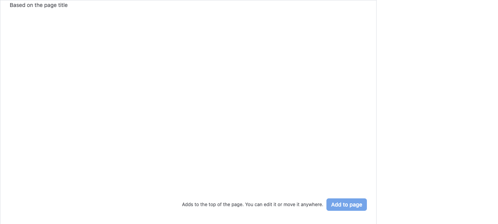
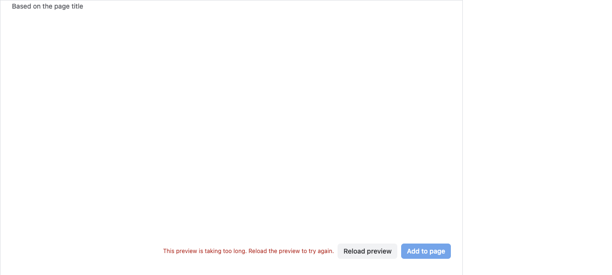
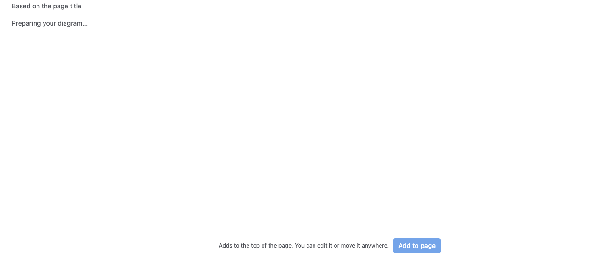
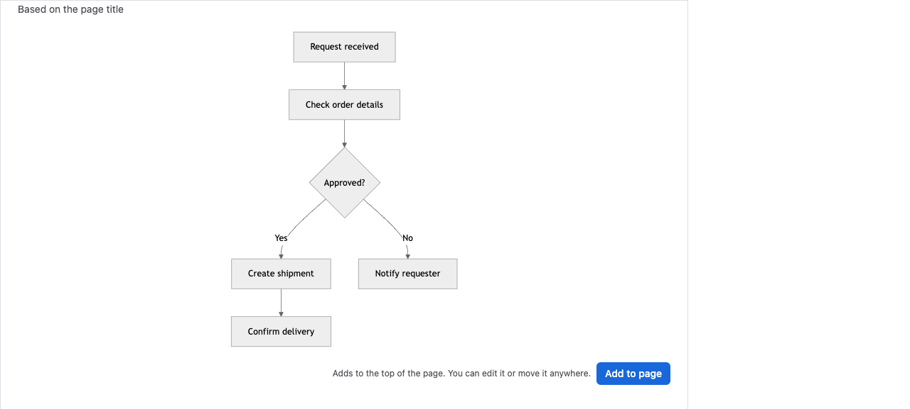
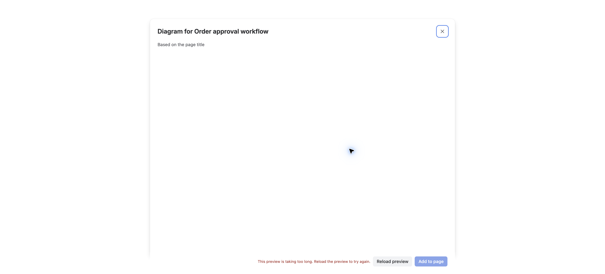
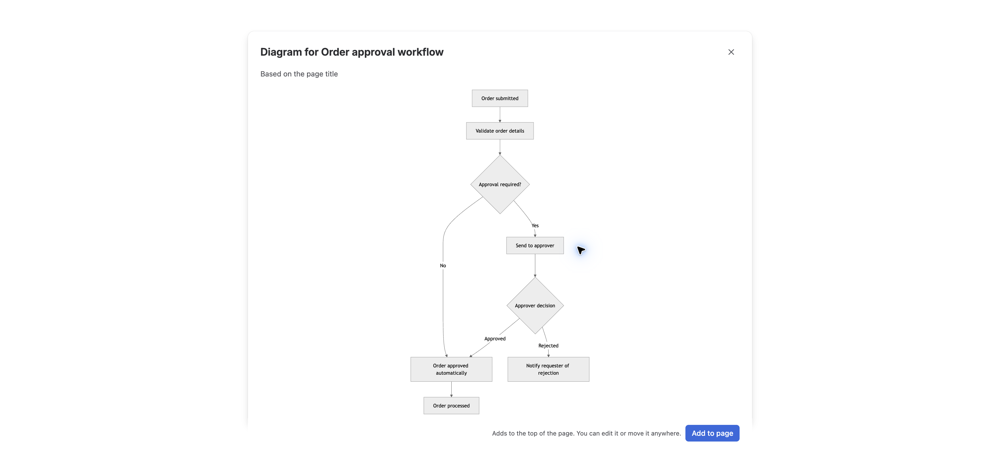
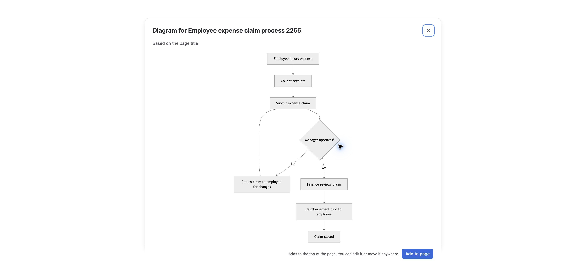
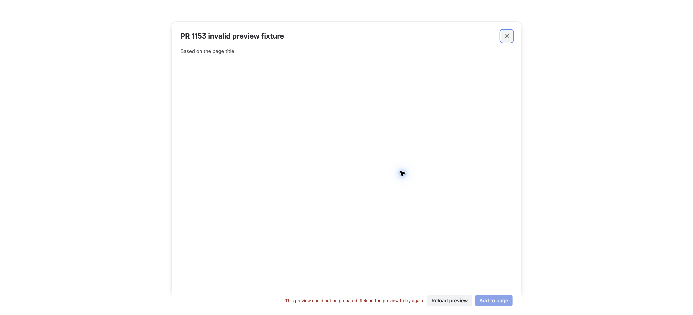

# PR #1153 public evidence

Baseline: `5fc739dd3e7a449e4052ac7d3bacceffb21e1bae`  
Candidate: `7dc2c46c5e30864bf4c4975333e6dac20579b33d`

## What the comparison shows

The screenshots use the same fictional Storybook Title Draft Ready component,
input, viewport, and local Vite setup. A small local reverse proxy holds the
Mermaid module request to reproduce a stalled render. On the baseline, the
preview remains blank after the wait, Add stays disabled, and no recovery action
appears (`before-stall.png`, browser log). On the candidate, a loading state is
visible, then the soft 10-second timeout shows a reload action
(`after-loading.png`, `after-stall.png`). Releasing the held request lets the
candidate render automatically (`after-ready.png`; `storybook-late-ready.json`).
The reload probe also produced a fresh ready document (`after-reload-ready.png`,
`storybook-reload.json`). The render-error state keeps the dialog open and offers
reload (`after-render-error.png`). The probe records that save was not invoked.

| Baseline after the stall | Candidate after the stall |
|---|---|
|  |  |

Candidate loading and recovery:

This reproduces the UI behavior with an intentionally delayed module request. It
does not establish a production transport root cause. The test uses the actual
Ready component served by Storybook/Vite and a controlled proxy; it is not a
customer page or a CI-deployed staging build.

## Reproduce

Run the project's Storybook/Vite host on the local port selected for your
environment, set `VITE_UPSTREAM` to that origin, and start `slow_proxy.py`. Set
`PROXY_URL` to the printed proxy origin, then run `python3 browser-probe.py
before` against the baseline build and `python3 browser-probe.py after` against
the candidate build. The proxy exposes `/__repro/hold`, `/__repro/release`, and
`/__repro/state`; after the timeout, release the held request to observe late
automatic recovery. `browser-probe.py` requires the `agent-browser` executable
and saves captures beside itself. Adjust its Storybook URL if the host uses a
different route.

## Forge Tunnel and CI Staging

Tunnel: the native modal served candidate Vite modules from localhost:8000.
An external 8080-to-8081 proxy held only the Mermaid ESM entry. The slow-state
screenshot shows the actual alert and disabled Add. Clicking Reload preview
reloaded the iframe. After the proxy's bounded hold ended, SVG rendered and Add
became enabled. SHA-256 of page ID, Mermaid source and experiment exposure was
identical before/after reload (`tunnel-reload-result.json`).

Staging: CI run 43384927822 deployed synthetic merge
`6042686ecae04a4fb48ef1635e8131f2d3a373f1`, containing PR head
`7dc2c46c5e30864bf4c4975333e6dac20579b33d`. The actual CDN bundle reported
`app_commit=6042686`, not localhost. An existing fictional page's native offer
opened a rendered preview with enabled Add (`staging-normal.json`). A second
native Forge modal was opened through the shipped bridge with an intentionally
invalid fictional Mermaid source. It showed the recoverable error and kept Add
disabled. Clicking Reload preview produced a fresh document (old window marker
absent), retained the exact page/source/context hash and showed the same expected
error (`staging-render-error.json`, `staging-after-reload.json`). Invalid source
is expected to remain invalid after reload; recovery is for transient failures.
This is an isolated invalid-input fixture, not a naturally generated draft.

Only the dialog is visible in live screenshots: an immediately removed temporary
CSS visibility mask hid unrelated Confluence chrome; dialog layout/content was
unchanged. Storybook screenshots have no mask. No customer data is included.
One earlier internal Tunnel fixture was accidentally added while automating;
its original text-only page was restored, the owned property removed, and owned
custom content and attachment deleted via admin REST after best-effort native
cleanup left the custom content. No customer page was changed. No Add was
invoked in the final slow/reload Tunnel fixture or either Staging fixture.

Mixpanel received delay, reload-click and subsequent rendered events for the
same internal exposure on `7dc2c46c`; durations/reasons are in
`received-analytics.json` with exposure IDs replaced by fixture labels. This
proves received test telemetry, not a customer conversion outcome.

## Validation status and limits

Storybook: PASS. Forge Tunnel normal/slow/reload/context: PASS. CI Staging
normal/rejected-render/reload/context: PASS. **Staging slow-resource injection:
SKIPPED**, because agent-browser's route did not intercept the cross-origin
iframe; a bounded direct CDP attempt did not establish a usable target. The
10-second delayed-import path is evidenced in Storybook and Tunnel, not Staging.
CI PR checks and PR validation succeeded; Viewer preview E2E and standalone
Export checks passed. Draft staging E2E is SKIPPED by workflow policy. Persistent
new-macro creation and existing-macro editing are outside this preview fix's
manual assertions; existing unit/modal integration tests cover Add callbacks.

See [`checks.txt`](checks.txt) for local test counts, setup failure disclosure,
exact SHAs and CI links. Production transport root cause remains unproven.

Current test-decision policy update: after the recorded CI run, the trusted
default-branch controller required a current explicit scenario decision.
The title-draft preview modal has no exact registered product/scenario coverage;
pr-labeling published TRIAGE for this head/base, with per-path impact evidence:
https://github.com/ZenUml/conf-app/pull/1153#issuecomment-6847158434
Thus current full Staging E2E is BLOCKED pending manual triage, rather than simply
being disabled by Draft status. No full-suite fallback or Ready transition was
requested. Independent basic checks and the recorded manual UI evidence remain
separate, observed results. The PR stays Draft. Staging render_error/reload-click
events were also received on the CI merge build, as recorded in the anonymized
telemetry file.
