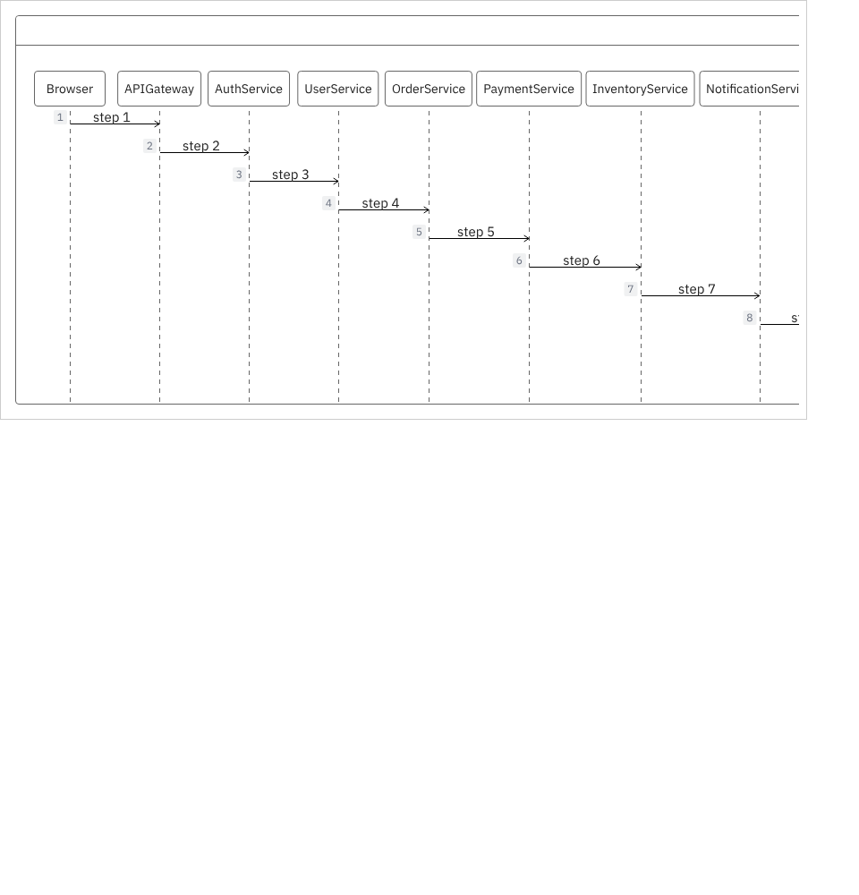
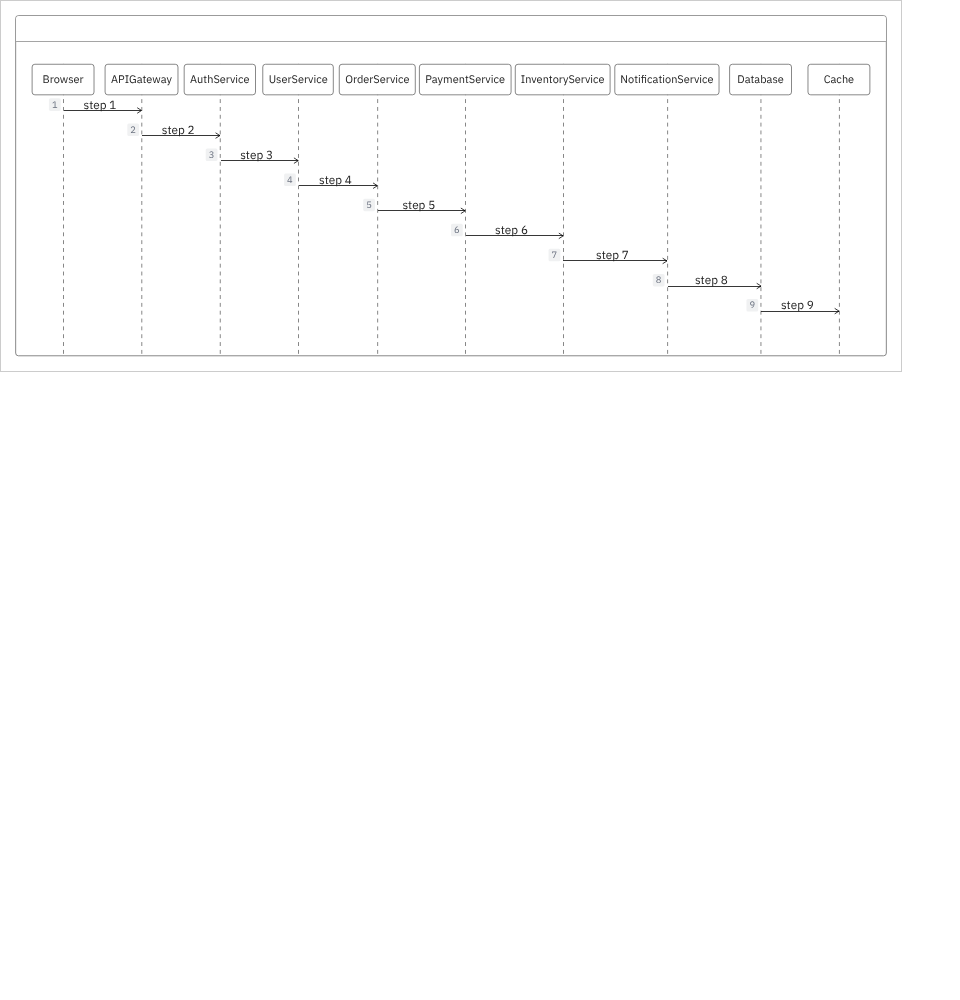

# PR #1176 evidence: fit ZenUML sequence diagrams to the MCP view's width

- BEFORE: `6736f3649` (`main`, merge-base). AFTER: `6679f1cd8` (PR head).
- Setup: `pnpm build:mcp-app` at each SHA, served by [`server.mjs`](server.mjs). This is a simulated MCP host: a cross-origin sandboxed iframe, 900 px wide, under the spec's CSP (`default-src 'none'`, `base-uri 'self'`, no `unsafe-eval`). Chromium 1.59 driven by Playwright, viewport 960×1000.
- Input: [`seqwide.json`](seqwide.json), a ZenUML diagram with 10 participants (`Browser->APIGateway: step 1` … `Database->Cache: step 9`). Probe: [`fitprobe.mjs`](fitprobe.mjs).

| | BEFORE | AFTER |
|---|---|---|
| layout width / view width | 1128 px / 884 px | 1128 px / 884 px |
| transform | none | `scale(0.783688)` |
| visible width | cut off at "NotificationService" (needs sideways scroll) | 884 px, all 10 participants |
| reported frame height | 467 | 370 |

A two-participant diagram (`A->B: hi`, 238 px) is unchanged after the fix: no transform, full size.

Limitations: this is a simulated host, not claude.ai.
