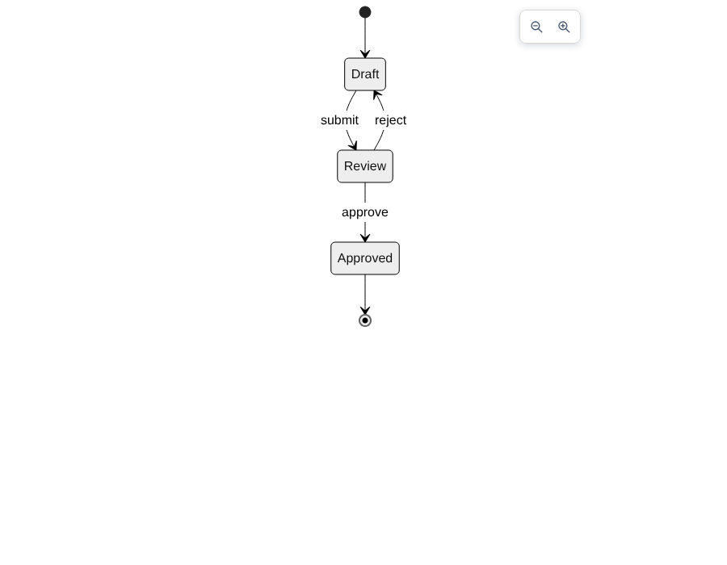

# PR #1178 evidence: hidden Mermaid render that cannot place its edge labels

- Baseline: `origin/main` at `68a9a607` (`Mermaid.vue` without the change)
- Candidate: `b375f802` (branch `fix/mermaid-suitable-point-layout-wait`)
- Mermaid: 11.17.2 (the version in `package.json`)

## 1. Root cause reproduction (`mermaid-no-layout-repro.js`)

Plain Mermaid 11.17.2 (`dist/mermaid.min.js`, copied next to the script) in Playwright Chromium,
`theme: 'neutral'` as in `src/utils/mermaid/loadMermaid.ts`. Synthetic diagrams only.

| Environment | class | er | state | flowchart with self-loop |
|---|---|---|---|---|
| normal document | OK | OK | OK | OK |
| `body { display: none }` | `svg element not in render tree` | same | **`Could not find a suitable point for the given distance`** | **same** |
| iframe `0x0` (has layout) | OK | OK | OK | OK |
| iframe `display: none` | `svg element not in render tree` | same | **`Could not find a suitable point…`** | **same** |

Mermaid throws the message from `calculatePoint` when the edge points it walks are `NaN`,
which is what layout produces when text cannot be measured.

## 2. Storybook (`storybook-capture.js`)

Story `Viewer/MermaidHiddenLayout` / `StateDiagramRevealedAfterHidden`: the preview `<body>` is
`display:none` while the first render runs, then revealed after 2 s. Captured 12 s after load,
viewport 900x700, `PRODUCT_TYPE=lite storybook dev`.

| | Before (baseline `Mermaid.vue`) | After (candidate) |
|---|---|---|
| Result | `{"svg":false,"edgeLabels":0}` | `{"svg":true,"edgeLabels":5}` |
| Console | `mermaid render error Error: Could not find a suitable point for the given distance` | no render error |
| Screenshot |  |  |

## Limitations

- Forge tunnel stage: blocked in the agent container (tunnel serves only the developer account behind
  `FORGE_EMAIL`; the browser can only sign in as the robot account).
- Staging stage: run separately after the branch's CI deploy; see the PR description.
