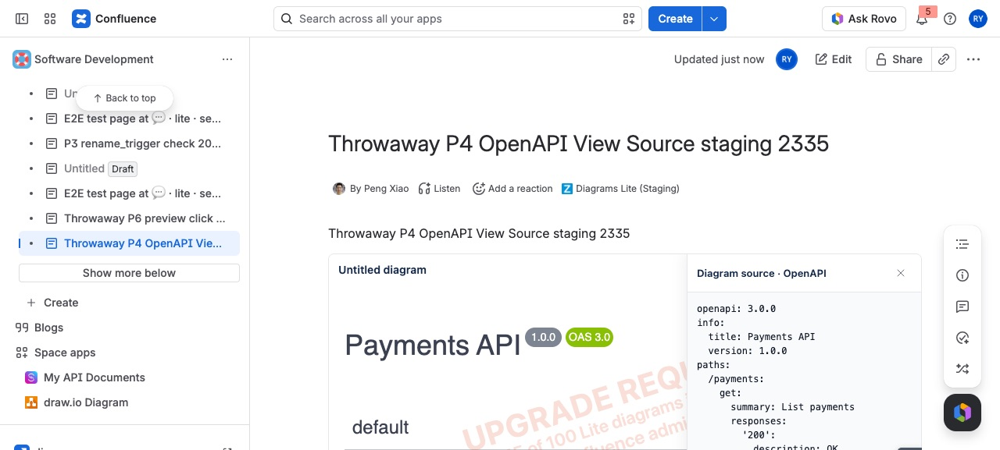

# PR 1218 evidence: View Source for OpenAPI macros

Candidate: `feat/openapi-view-source` (commits 7fd13e76, 661884f0). Baseline: `main` cff157ef.

| File | Stage | What it shows |
|---|---|---|
| before-dev-no-source.jpg | lite-dev, deployed dev build (another branch, `codex/replay-oc…@201e8f`), no tunnel | OpenAPI macro header: no Source button |
| storybook-openapi-inline.jpg | Storybook, real OpenApiViewer (Swagger UI) | Source panel inline, YAML as stored, 16 lines, Copy |
| storybook-openapi-fullscreen.jpg | Storybook | Source panel in Fullscreen |
| storybook-openapi-13001-lines.jpg | Storybook | 13,001-line spec scrolled to the end (resource-2165) |
| storybook-openapi-large-inline-capped.jpg | Storybook | Inline panel capped at 560px on a 130,218px-tall macro |
| tunnel-small-inline.jpg | lite-dev via Forge tunnel (dev bar `feat/openapi-vi…@7fd13e`) | Source panel in the real Forge iframe |
| tunnel-large-inline-BEFORE-cap.jpg | lite-dev via tunnel, before 661884f0 | Panel as tall as the macro; header and Copy out of view |
| tunnel-large-inline-AFTER-cap.jpg | lite-dev via tunnel, after 661884f0 | Bounded panel, 13,001 lines, Copy in view |
| tunnel-large-fullscreen.jpg | lite-dev via tunnel | Fullscreen Source panel, full viewport height |

Fixtures: fictional specs ("Payments API", "Large API" with 2,166 generated paths), created with the create-test-page skill on the internal lite-dev site.

Measurements (Storybook, Chrome, 1280x800, pane in background): 13,001-line / 255,598-character spec, click to layout 218 ms; inline panel 130,216px before the cap, 560px after; Fullscreen panel 800px (viewport).

Copy: clicked in the Forge iframe on lite-dev, button changed to "Copied". Clipboard contents not read back.

Not related to this PR: the tooltip "Diagram backup could not be saved" on the 256 KB test macro also appears on the deployed build without this branch.

## CI staging (lite-stg, PR validation run 44295747666, head 661884f0)

Source button shown; panel title "Diagram source · OpenAPI"; 16 lines, stored YAML unchanged.
