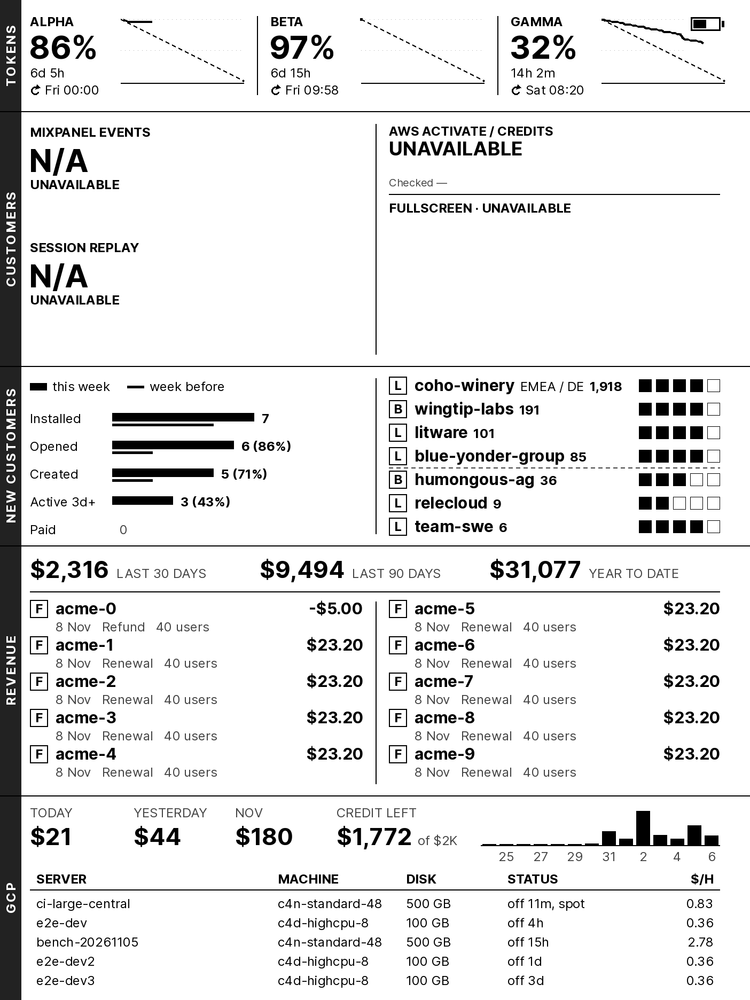

# PR #1322: production e-ink source snapshot

Conf App baseline: `ad6ec05505f88df19bba76f62a8f800a5e345ac3`.
Imported candidate: `aee440fed639275322b4401149ee84f88f09043c`.

The comparison is the former local production board source versus the candidate's
`ink-display/board`, using each checkout's `fixtures/sample.json` and `preview.py`.
Both render 1404×1872 images. These synthetic fixture images are byte-identical;
they contain fictional customers and are not live customer or billing data.




The original and candidate each passed 187 existing Python tests. The attached
[candidate output](python-tests.txt) is from the committed source, using Python
3.14 and Pillow 13.0.0:

```sh
python -m unittest discover -s ink-display/board -p 'test_*.py'
```

The snapshot preserves 42 copied source/test/fixture/documentation files byte for
byte. Metadata, the font license, and launchd path templates are separate additions
or intentional changes. Gitleaks found no leaks; nine representative private,
cache, configuration and history paths were excluded by the import allowlist.

This demonstrates preserved fixture rendering and existing test behavior, not
physical tablet delivery or successful production cutover. Those checks occur
after merge. Confluence visual stages are not applicable: no Confluence UI changed.
Current repository CI and subsequent cutover results are linked in the PR.
