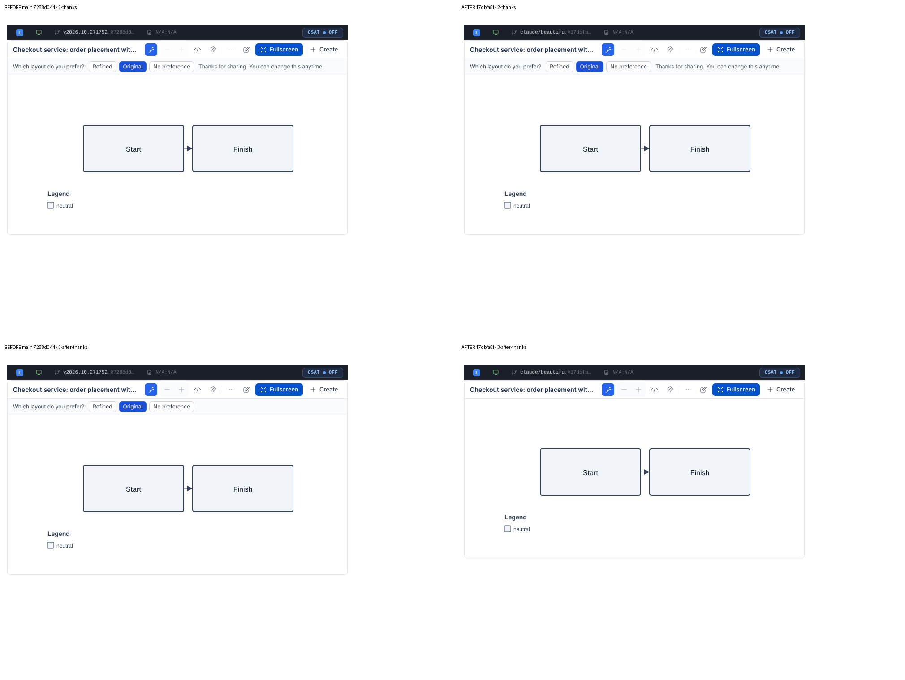

# PR #1346 evidence: the inline layout survey keeps an unstored vote

- BEFORE: `7288d044` (`main`, the PR base). AFTER: `17dbfa5f` (PR head).
- Change: `loadMagicFeedback` in `src/components/Viewer/GenericViewer.vue` keeps this view's own vote for the same feedback generation when storage returns nothing.

## The bug

Below the Refined toggle, the inline "Which layout do you prefer?" strip thanks the voter and retires 4 s later. `loadMagicFeedback` runs twice: once when the Magic artifact proves available, and again after the Magic view attaches.

A viewer with no storage key keeps the vote only in the component. That covers an anonymous viewer, who has no `accountId`, and a browser that blocks localStorage. When the second load landed after the click, it re-read `null`, and the strip stayed after the thank-you.

The same race made the unit test "shows the layout survey strip inline, thanks the voter, then retires it" fail about 1 run in 10 under load.

## Storybook, BEFORE vs AFTER: `scripts/survey-race.cjs`

- **Story:** `Viewer/GenericViewer` → "Staged header — Mermaid, long title, Refined" (`viewer-genericviewer--staged-header-mermaid-long-title`), PRODUCT_TYPE=lite.
- **Environment:** `storybook dev`, Chromium via Playwright, viewport 1000×720. BEFORE was served from a `7288d044` worktree on port 6007, AFTER from `17dbfa5f` on port 6006. The Storybook header in each screenshot shows the build it came from.

Steps, identical for both:
1. Set the component's `currentAccountId` to `null`, so the viewer has no storage key, as for an anonymous viewer.
2. Click **Original** and wait for "Thanks for sharing".
3. Call `loadMagicFeedback(diagram.magic, diagram.mermaidCode)`, the second load the Magic view's attach triggers, forced to land after the click.
4. Wait 4.6 s, then screenshot.

| State | BEFORE `7288d044` | AFTER `17dbfa5f` |
|---|---|---|
| after the click | `previous: "original"`, `thanked: true` | same |
| after the late reload | **`previous: null`** | `previous: "original"` |
| 4.6 s later | **strip still visible**, asking again | strip retired |

Individual frames: `storybook/{before,after}-{1-survey,2-thanks,3-after-thanks}.png`.

## Unit tests, same machine

- New test "keeps a vote it could not store when the feedback reloads after the click": fails on BEFORE (`magicPreviousFeedback` is `null` after the reload), passes on AFTER.
- The flaky test under 4-core CPU load: BEFORE failed 2 of 20 runs, at `GenericViewer.spec.ts:518`. AFTER passed 40 of 40, run together with the new test.

## Limits

This Storybook check forces the race by calling the second load directly. It shows that the component no longer drops the vote, not how often the race happens on a real page. The Forge tunnel and staging checks are recorded on the PR.
