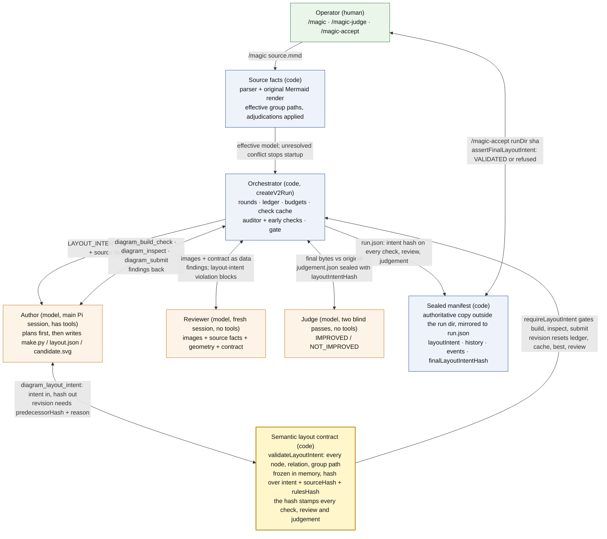
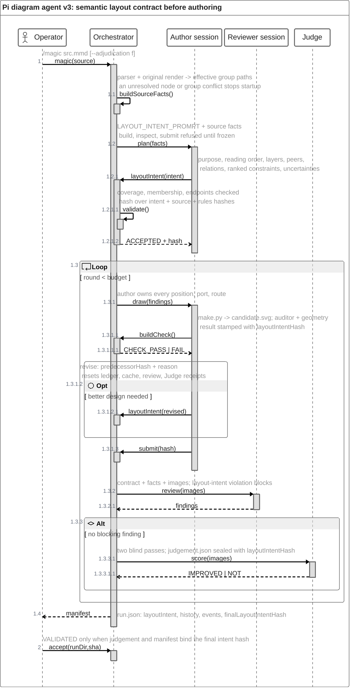
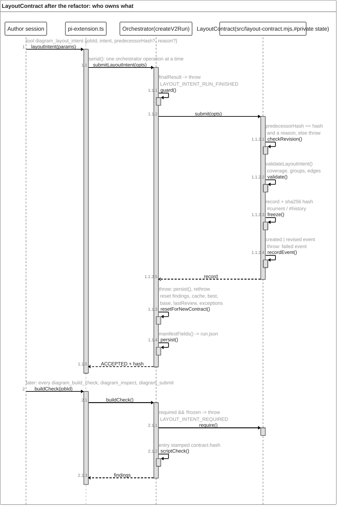

# Pi diagram agent: semantic layout contract (high-level design)

How a `/magic` run on this branch works: the author must freeze a source-bound semantic layout contract (`diagram_layout_intent`) before any build, inspection or submit; every later check, review, judgement and acceptance is stamped with that contract's hash. Rendered: [semantic-layout-contract-roles.svg](semantic-layout-contract-roles.svg) (roles) and [semantic-layout-contract.svg](semantic-layout-contract.svg) (one run).

## Roles and trust boundaries

Deterministic code (blue) owns run state, hashes, the auditor, the gate and the manifest. Three model sessions (orange) never share context: the author plans and draws, the reviewer sees images plus the contract, the judge scores blind. The contract (yellow) is the spine: its hash is stamped on every check, review and judgement, and acceptance refuses a final hash that does not match.

Code: `src/layout-contract.mjs` (`LayoutContract`: freeze, revise, events, manifest fields) and `src/layout-intent.mjs` (`validateLayoutIntent`, `hashLayoutIntent`, the planning prompt). The orchestrator only calls `require()`, `submit()` and `manifestFields()` and resets its own round state after a revision.

## One `/magic` run

Planning is the first phase of the same author session and spends the same token and wall-clock budget. The auditor and source-facts steps are orchestrator self-calls here to keep the diagram at five participants.

## Contract object after the refactor

Who owns what once the contract is its own object: the orchestrator serialises, guards a finished run, resets its own round state and writes the manifest; `LayoutContract` validates, freezes, revises and records events behind private fields. Rendered: [layout-contract-sequence.svg](layout-contract-sequence.svg).

Diagnostics: `magic_layout_intent_created`, `magic_layout_intent_revised` and `magic_layout_contract_failed` are recorded in `run.json` only; the CLI sends no analytics.
